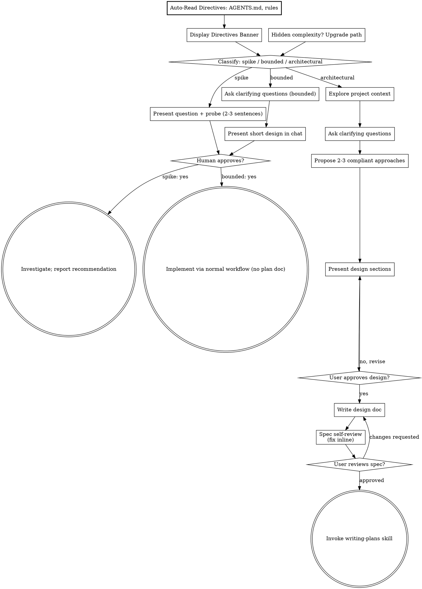

# Project Brainstorming

Help turn ideas into fully formed designs and specs through natural collaborative dialogue, strictly grounded in the repository's master directives and architectural rules.

<HARD-GATE>
1. **AUTOMATIC INJECTION GATE (MANDATORY PRE-FLIGHT TOOL EXECUTION)**:
   You MUST call file-reading tools (`view_file` or `client_view_file`) on the repository's directive files (`AGENTS.md`, `CLAUDE.md`, `.cursorrules`, `docs/rules/*`) BEFORE sending any chat message, before path classification, and before asking clarifying questions.
   DO NOT rely on assumptions, pre-training knowledge, or general framework conventions. You MUST inspect the actual file contents via tool calls on Turn 0.
2. **NO VIOLATION IN PROPOSALS**:
   Never propose approaches, libraries, or patterns that violate the detected project directives (e.g., entity leakage, forbidden annotations, direct cross-module service injection, raw SQL joins instead of Facade/Lookups).
3. **HUMAN APPROVAL GATE**:
   Do NOT invoke any implementation skill, write any code, scaffold any project, or create an implementation plan until you have told your human partner what you intend and they have explicitly approved it.
</HARD-GATE>

---

## Phase 0: Automated Directives Ingestion (Turn-0 Execution)

Upon invoking this skill, before producing your first text output or asking questions, execute these read steps in order:

### 1. Root Directives Auto-Read (Tool Execution)
Check and read whichever exists in the workspace root:
- `AGENTS.md` (or `CLAUDE.md` symlink)
- `.cursorrules` / `.windsurfrules` / `.github/copilot-instructions.md`
- `CONVENTIONS.md` / `CONTRIBUTING.md`

### 2. Companion Rules Scan
If master directives reference `docs/rules/`, `docs/architecture/`, or `docs/guidelines/`, inspect the relevant rule files for the target feature domain.

### 3. Extract & Display Injection Confirmation
In your very first response message to the user, display the mandatory injection banner:

```markdown
> [!NOTE]
> **Directives Auto-Injected**: Loaded [`AGENTS.md`](file:///path/to/AGENTS.md).
> *Core Invariants*: [e.g., Java 21 | Spring Boot | 2-Layer Modular Monolith | Facade Contract only | Record DTOs (no Entity leakage) | YAVI Validation]
```

---

## Three Paths

After injecting directives, classify the request aloud before asking questions — *"this looks bounded, so I'll present a short design here rather than write a spec"* — so your human partner can override it:

- **Spike** — a feasibility question ("can we...", "is it possible...", "quick and dirty is fine") whose output is an answer, not code you keep. The probe must respect architectural boundaries. Present the question, directives constraint, and what you'll try in 2-3 sentences, get a nod, then find out as cheaply as correctness allows. No design doc, no spec file. Report findings as a recommendation; anything you built stays labeled throwaway.
- **Bounded** — a well-scoped change to code that already exists in this repo: a new endpoint on an existing module, a small feature extension, a one-file fix. Understanding the kind of app is not enough — bounded means the flow you are changing is already here to read. If there is no existing flow to change, the task is not bounded. Ask the clarifying questions that matter, present a short design IN CHAT (approach, modules/files touched, directives compliance checklist, targeted testing), and STOP. Implementation starts only after your human partner says yes to that design — a bounded task's approval is as hard a gate as an architectural one. No spec file, no implementation plan document.
- **Architectural** — new modules/subsystems, new domain concepts, changes that restructure how components fit together or alter interfaces others depend on. Follow the full process: questions, 2-3 compliant approaches with trade-offs, sectioned design in chat, written spec saved to `docs/superpowers/specs/`, spec self-review, user review gate, then the `writing-plans` skill.

When in doubt between two paths, take the heavier one. The ratchet is one-way: hidden complexity discovered mid-task upgrades the path — stop, say so, and step up. Nothing downgrades mid-task.

---

## Anti-Pattern: "Too Simple To Need Approval"

Every path ends with your human partner approving your intent before implementation. A todo list, a single-function utility, a config change — the design may be two sentences in chat, but you MUST present it and get approval. "Simple" tasks are where unexamined assumptions cause the most wasted work. What scales with simplicity is the artifact, never the approval.

## Red Flags

| Thought / Rationalization | Reality |
|---------------------------|---------|
| "I know standard Spring Boot / framework patterns, so I don't need to read `AGENTS.md`." | Generic patterns often violate repo-specific rules (e.g., using `@Autowired` or returning JPA entities). Tool execution to read `AGENTS.md` is mandatory. |
| "I'll read `AGENTS.md` later after asking questions." | Asking questions without directives context leads to asking the wrong questions or proposing invalid options. Read FIRST. |
| "This is too simple to need a design" | Simple means a short design, not no design. Two sentences in chat, then approval. |
| "I'll call it bounded and skip the spec" | Reaching for a label to skip work IS the doubt — take the heavier path. |
| "It's bounded and the design is obvious — I'll start while they read it" | The gate is the approval, not the design's length. Present, then stop until you hear yes. |
| "Direct DB join across modules is much simpler here." | Directives strictly prohibit breaking modular boundaries. Design with in-memory lookup or Facade contracts instead. |
| "The spike works, so I'll keep the code" | A spike's output is an answer. Keeping the code is a new request — classify it. |
| "It grew, but I'm almost done — no need to re-classify" | Hidden complexity upgrades the path mid-task. Stop and say so. |

---

## Checklist

Classify first, announce the path, then create a task for each item on your path and complete them in order.

**Spike:**
0. **Auto-inject directives via tool calls** — read `AGENTS.md` / `CLAUDE.md` and display banner
1. **Explore project context** — inspect relevant domain files
2. **Present question + probe plan** — 2-3 sentences with architectural boundaries noted
3. **Get approval** — a nod is enough
4. **Investigate** — as cheaply as correctness allows
5. **Report findings** — a recommendation; label anything built as throwaway

**Bounded:**
0. **Auto-inject directives via tool calls** — read `AGENTS.md` / `CLAUDE.md` and display banner
1. **Explore project context** — verify existing module conventions & files
2. **Ask clarifying questions** — one at a time, the ones that matter
3. **Present short design in chat** — approach, modules & files touched, directives compliance checklist, targeted testing
4. **Get approval** — STOP and wait for an explicit yes; presenting the design and starting in the same breath is skipping the gate
5. **Implement** — proceed with the normal development workflow (TDD applies); no plan document

**Architectural:**
0. **Auto-inject directives via tool calls** — read `AGENTS.md`, `CLAUDE.md`, and relevant `docs/rules/*`, display banner
1. **Explore project context** — examine affected domain directories and schema
2. **Offer the visual companion just-in-time** — NOT upfront. The first time a question would genuinely be clearer shown than described, offer it then (its own message); on approval its browser tab opens for you.
3. **Ask clarifying questions** — one at a time, understand purpose/constraints/success criteria
4. **Propose 2-3 approaches** — with trade-offs, recommendation, and explicit directives compliance check for each
5. **Present design in sections** — scaled to complexity, get user approval after each section (covering architecture, facade contracts, data flow, validation, testing)
6. **Write design doc** — save to `docs/superpowers/specs/YYYY-MM-DD-<topic>-design.md` (do not auto-commit)
7. **Spec self-review** — quick inline check for placeholders, contradictions, ambiguity, scope (see below)
8. **User reviews written spec** — ask user to review the spec file before proceeding
9. **Transition to implementation** — invoke writing-plans skill to create implementation plan

---

## Process Flow



**Terminal states are path-bound:**
- **Architectural**: The ONLY skill you invoke after brainstorming is `writing-plans` — never jump directly to code.
- **Bounded**: After approval, implementation proceeds directly through the normal development workflow (targeted tests, DoD checklist); no plan document.
- **Spike**: The terminal state is a reported recommendation.

---

## The Process

### Understanding the Idea
- Complete Phase 0 (Directives Ingestion) first.
- Before asking detailed questions, assess scope: if the request describes multiple independent subsystems, flag this immediately. Help user decompose into sub-projects: what are the independent pieces, how do they relate, what order should they be built? Then brainstorm the first sub-project through the normal design flow. Each sub-project gets its own spec → plan → implementation cycle.
- For appropriately-scoped projects, ask questions one at a time to refine the idea.
- Prefer multiple choice questions when possible, but open-ended is fine too.
- Only one question per message — if a topic needs more exploration, break it into multiple questions.
- Focus on understanding: purpose, constraints, success criteria.

### Exploring Approaches
- Propose 2-3 different approaches with trade-offs.
- **Directives Compliance Check**: Explicitly verify how each approach conforms to project directives (e.g., inter-module boundary via Facade, record DTOs, query strategy). Eliminate or flag approaches that violate master rules.
- Present options conversationally with your recommendation and reasoning.
- Lead with your recommended option and explain why.
- YAGNI ruthlessly — remove unnecessary features from every approach and design.

### Presenting the Design
- Once you believe you understand what you're building, present the design.
- Scale each section to its complexity: a few sentences if straightforward, up to 200-300 words if nuanced.
- Ask after each section whether it looks right so far.
- Cover: architecture & package structure, contracts (Facade/DTO), data flow, validation rules, error handling, targeted testing.
- Be ready to go back and clarify if something doesn't make sense.

### Design for Isolation and Clarity
- Break the system into smaller units that each have one clear purpose, communicate through well-defined interfaces (e.g., `facade/<Feature>Facade.java`), and can be understood and tested independently.
- For each unit, answer: what does it do, how do you use it, and what does it depend on?
- Smaller, well-bounded units are also easier to maintain and test with targeted test commands.

### Working in Existing Codebases
- Explore the current structure before proposing changes. Follow existing patterns.
- Where existing code has problems that affect the work, include targeted improvements as part of the design.
- Don't propose unrelated refactoring. Stay focused on what serves the current goal.

---

## After the Design (Architectural Path)

### Documentation
- Write the validated design (spec) to:
  `docs/superpowers/specs/YYYY-MM-DD-<topic>-design.md`
  *(User preferences for spec location override this default)*
- Do NOT auto-commit the design document. Leave committing files to the user or explicit instructions.

### Spec Self-Review
After writing the spec document, look at it with fresh eyes:
1. **Placeholder scan:** Any "TBD", "TODO", incomplete sections, or vague requirements? Fix them.
2. **Internal consistency & Directives check:** Do any sections contradict each other or violate `AGENTS.md` (e.g., entity leakage, missing Facade)?
3. **Scope check:** Is this focused enough for a single implementation plan, or does it need decomposition?
4. **Ambiguity check:** Could any requirement be interpreted two different ways? If so, pick one and make it explicit.

Fix any issues inline. No need to re-review — just fix and move on.

### User Review Gate
After the spec review passes, ask the user to review the written spec before proceeding:

> "Spec written and saved to `<path>`. Please review it and let me know if you want to make any changes before we start writing out the implementation plan."

Wait for the user's response. If they request changes, make them and re-run the spec review loop. Only proceed once the user approves.

### Transition to Implementation
- Invoke the `writing-plans` skill to create a detailed implementation plan in `docs/superpowers/plans/`.
- Do NOT invoke any other skill. `writing-plans` is the next step.

---

## Visual Companion

A browser-based companion for showing mockups, diagrams, and visual options during brainstorming. Available as a tool — not a mode.

**Offering the companion (just-in-time):** Do NOT offer it upfront. Wait until a question would genuinely be clearer shown than told — a real mockup / layout / diagram question. The first time that happens, offer it then, as its own message:
> "This next part might be easier if I show you — I can put together mockups, diagrams, and comparisons in a browser tab as we go. It's still new and can be token-intensive. Want me to? I'll open it for you."

If they accept, use the collaborative preview or HTML rendering tools. If they decline, continue text-only.
