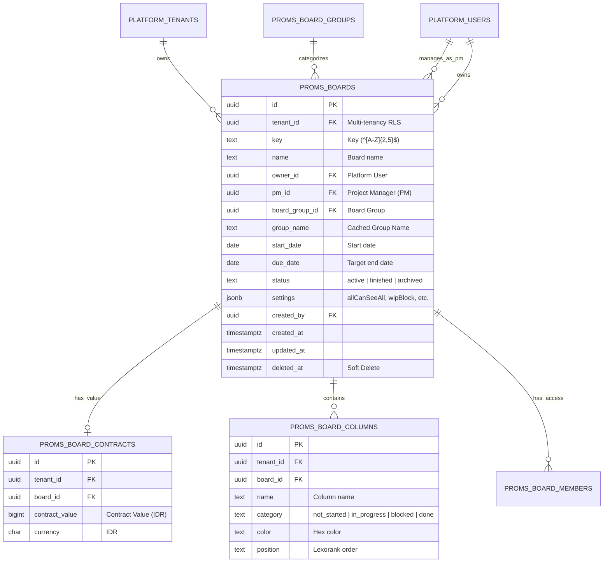

# [RFC/TDD] Feature: Boards Management - Create New Board Modal (Mobile & Web)

- **Status**: `PROPOSED / IN REVIEW`
- **Authors**: Engineering Team
- **Figma Reference**: [Figma Link: M-07 Boards / add board (Mobile Bottom Sheet / Modal)](https://figma.com/file/...)
- **Target Release**: Sprint 45 (Mobile & Web Parity)
- **Reviewers**: Enterprise Security Architect, Data Architect, QA Lead

---

## 1. Executive Summary & UI Context

Layar `M-07 Boards / add board` merupakan alur inisiasi project/kanban board baru. Fitur ini menangani pembuatan workspace baru, penetapan workflow task, penentuan jadwal sprint/proyek, privasi/akses board, nilai kontrak, serta penugasan penanggung jawab (*Project Manager*).

Untuk menghindari beban *monolithic pre-fetch* dan menjaga prinsip **Modular Architecture** di mana setiap domain (`identity`, `pm.board`, `pm.workflow`) mengelola referensinya sendiri, data pendukung form dipecah berdasarkan scope **`<domain>.<feature>`**:
1. **`pm.board`**: Mengambil daftar grup board (`GET /api/v1/boards/groups`).
2. **`identity.user`**: Mengambil kandidat Project Manager / member tenant (`GET /api/v1/users/pm-candidates`).
3. **`pm.workflow`**: Mengambil preset kolom kanban workflow (`GET /api/v1/boards/workflow-templates`).

### 1.1 UI Component to API Traceability Matrix

| UI Screen / Component | User Action | HTTP Method & Path | Scoped Domain | Failure State UI Handling |
| :--- | :--- | :--- | :--- | :--- |
| `Dropdown: Board Group` | Lazy load / Modal open | `GET /api/v1/boards/groups` | `pm.board` | Skeleton dropdown -> Default empty state jika belum ada grup dibuat |
| `Dropdown: Project Manager (PM)` | Search / Select user | `GET /api/v1/users/pm-candidates` | `identity.user` | Menampilkan avatar & nama. Fallback default ke user yang sedang login (`currentUser`) |
| `Dropdown: Kanban columns` | Pilih template alur kerja | `GET /api/v1/boards/workflow-templates` | `pm.workflow` | Radio/Dropdown daftar template. Default: `Default Workflow` |
| `Input: Board name*` & `Key*` | Input nama & blur trigger key generation | Client-side acronym generation + validation | `pm.board` | Validasi lokal regex `^[A-Z]{2,5}$`. Border merah jika karakter tidak valid |
| `Section: SCHEDULE` (`Start date` & `Target end date`) | Pilih tanggal via date picker | Client-side reactive calculation | `pm.board` | Label dinamis: *"Project duration: X months"*. Jika `due_date < start_date`, tampilkan inline error |
| `Input: Contract Value (Optional)` | Input nominal IDR | Form formatting client-side | `pm.board` | Masking format IDR (`Rp. 150.000.000`). Mapping ke entitas `proms.board_contracts` |
| `Toggle: Private Board` | Toggle switch | Form state toggle | `pm.board` | Update JSONB `settings.allCanSeeAll = !isPrivate` |
| `Button: Create Board` | Klik "Create Board" (Submit CTA) | `POST /api/v1/boards` | `pm.board` | Button disable + spinner -> Tutup modal & redirect jika sukses. Pop-up conflict jika Key terduplikasi (409) |
| `Button: Cancel` / Icon `(X)` | Klik cancel / close | Client-side action | - | Pop-up dialog *"Discard changes?"* jika input telah diubah |

---

## 2. Database Schema & Migration Mapping (Aligned with `04-proms-tables.sql`)

Struktur tabel di bawah ini diselaraskan 100% dengan migration Liquibase proyek (`schema: proms`).



### 2.1 Table: `proms.boards` (Tabel Utama)
Sesuai changeset `04-tbl-boards` di [`04-proms-tables.sql`](file:///home/kholifan/html/project-promps/api/src/main/resources/db/changelog/changes/04-proms-tables.sql#L219-L252):

| Column Name | Data Type | Constraint | UI Element Mapping | Deskripsi / Business Rules |
| :--- | :--- | :--- | :--- | :--- |
| `id` | `uuid` | PK, Default `gen_random_uuid()` | - | Primary Key |
| `tenant_id` | `uuid` | Not Null, RLS Protected | Context Session / Token | Multi-tenancy isolation (`platform.current_tenant()`) |
| `key` | `text` | Not Null, Constraint `key ~ '^[A-Z]{2,5}$'` | Input: `Key*` | Prefix kode task (contoh: `AAM`, `PRO`) |
| `name` | `text` | Not Null | Input: `Board name*` | Nama board |
| `board_group_id` | `uuid` | FK to `proms.board_groups.id` | Dropdown: `Board Group` | Grup/Kategori board (e.g. Development) |
| `group_name` | `text` | Nullable | Auto-filled from group | Denormalisasi nama grup untuk optimasi query list |
| `owner_id` | `uuid` | Not Null, FK to `platform.users` | Default: Creator | Pemilik utama board (User yang login) |
| `pm_id` | `uuid` | Nullable, FK to `platform.users` | Dropdown: `Project Manager (PM)` | Penanggung jawab teknis board |
| `status` | `text` | Default `'active'`, Check in `('active', 'finished', 'archived')` | Default: `active` | Status siklus hidup board |
| `start_date` | `date` | Nullable | Picker: `Start date` | Tanggal mulai proyek |
| `due_date` | `date` | Nullable, Check `(start_date <= due_date)` | Picker: `Target end date` | Tanggal target selesai |
| `settings` | `jsonb` | Default JSON object | Toggle: `Private Board` | Jika Private Board **ON** -> `{"allCanSeeAll": false}`, jika **OFF** -> `{"allCanSeeAll": true}` |
| `created_by` | `uuid` | FK to `platform.users` | Context User | User pembuat record |
| `created_at` | `timestamptz` | Default `now()` | - | Audit trail create |
| `updated_at` | `timestamptz` | Default `now()` | - | Audit trail update |
| `deleted_at` | `timestamptz` | Nullable | - | Soft delete flag |

### 2.2 Table: `proms.board_contracts` (Nilai Kontrak)
Sesuai changeset `04-tbl-board_contracts` di [`04-proms-tables.sql`](file:///home/kholifan/html/project-promps/api/src/main/resources/db/changelog/changes/04-proms-tables.sql#L45-L58):

| Column Name | Data Type | Constraint | UI Element Mapping | Deskripsi / Business Rules |
| :--- | :--- | :--- | :--- | :--- |
| `id` | `uuid` | PK, Default `gen_random_uuid()` | - | Primary Key |
| `tenant_id` | `uuid` | Not Null | Context Session | Multi-tenancy isolation |
| `board_id` | `uuid` | Not Null, FK to `proms.boards` | Relasi Board | Relasi 1-to-1 ke tabel board |
| `contract_value` | `bigint` | Not Null, Check `>= 0` | Input: `Contract Value (Optional)` | Nilai nominal kontrak dalam Rupiah penuh |
| `currency` | `character(3)`| Default `'IDR'` | Prefix `Rp.` | Mata uang kontrak |

---

## 3. Security & Compliance
- **Authentication**: JWT via header `Authorization: Bearer <token>`.
- **Authorization / RBAC**: Hanya user dengan role `TENANT_ADMIN`, `PROJECT_MANAGER`, atau izin `proms:board:create` yang diizinkan membuat board.
- **PostgreSQL Row-Level Security (RLS)**: Semua query terproteksi RLS `tenant_isolation ON proms.boards USING (tenant_id = platform.current_tenant())`.
- **Idempotency**: Wajib menyertakan header `Idempotency-Key: <UUIDv4>` pada endpoint `POST /api/v1/boards`.

---

## 4. Rate Limiting & NFR (Non-Functional Requirements)
- **Rate Limit**: Max 30 requests / menit per user ID pada endpoint pembuatan board (`429 Too Many Requests`).
- **SLA P95 Latency**: 
  - Reference/Metadata endpoints: `< 80ms` (didukung L1 Cache Caffeine + Redis).
  - `POST /api/v1/boards`: `< 250ms`.
- **Modular Monolith Facade**: Modul `pm.board` memanggil user data melalui `UserFacade` (`module.identity.user`), bukan melakukan direct SQL join ke tabel `platform.users`.

---

## 5. Endpoints Breakdown & Schemas

### 5.1 Scoped Reference Endpoints (Data Pendukung Form)

Setiap dropdown dilayani oleh endpoint dengan batasan domain yang jelas:

#### A. Scope: `pm.board` - Board Groups
- **Endpoint**: `GET /api/v1/boards/groups`
- **Tujuan**: Mengambil daftar kategori grup board milik tenant aktif.
- **Response 200 OK**:
```json
{
  "success": true,
  "code": "OK",
  "message": "Daftar grup board berhasil diambil",
  "data": [
    {
      "id": "b2f0ec35-7164-42f5-b38e-01a2f90a991b",
      "name": "Development",
      "icon": "folder-code"
    },
    {
      "id": "e221bca9-5432-4781-9981-55bb21a78822",
      "name": "Marketing",
      "icon": "folder-trend"
    }
  ]
}
```

#### B. Scope: `identity.user` - Project Manager Candidates
- **Endpoint**: `GET /api/v1/users/pm-candidates`
- **Query Params**: `q` (opsional untuk search nama/email)
- **Tujuan**: Mengambil daftar member dalam tenant yang memiliki kapabilitas atau role sebagai Project Manager.
- **Response 200 OK**:
```json
{
  "success": true,
  "code": "OK",
  "message": "Daftar kandidat PM berhasil diambil",
  "data": [
    {
      "id": "c4587df1-3bf1-423c-a7c8-718e4726bf66",
      "name": "Yohan Aris",
      "email": "yohan.aris@hyperdata.com",
      "avatarUrl": "https://cdn.perusahaan.com/avatars/ya.png",
      "initials": "YA",
      "isCurrentUser": true
    },
    {
      "id": "7f13a0e4-b789-4911-85bc-229048a1d120",
      "name": "Sarah Jenkins",
      "email": "sarah.j@hyperdata.com",
      "avatarUrl": null,
      "initials": "SJ",
      "isCurrentUser": false
    }
  ]
}
```

#### C. Scope: `pm.workflow` - Kanban Workflow Templates
- **Endpoint**: `GET /api/v1/boards/workflow-templates`
- **Tujuan**: Mengambil daftar template kolom Kanban awal untuk inisiasi board.
- **Response 200 OK**:
```json
{
  "success": true,
  "code": "OK",
  "message": "Template workflow berhasil diambil",
  "data": [
    {
      "id": "default-workflow",
      "name": "Default Workflow",
      "description": "Standar kanban 4 kolom",
      "isDefault": true,
      "columns": [
        { "name": "Backlog", "category": "not_started", "color": "#1E293B" },
        { "name": "Ready", "category": "not_started", "color": "#2563EB" },
        { "name": "On Progress", "category": "in_progress", "color": "#F59E0B" },
        { "name": "Blocked", "category": "blocked", "color": "#EF4444" }
      ]
    },
    {
      "id": "simple-kanban",
      "name": "Simple Kanban",
      "description": "Alur 3 kolom sederhana",
      "isDefault": false,
      "columns": [
        { "name": "To Do", "category": "not_started", "color": "#1E293B" },
        { "name": "In Progress", "category": "in_progress", "color": "#F59E0B" },
        { "name": "Done", "category": "done", "color": "#10B981" }
      ]
    }
  ]
}
```

---

### 5.2 Create Board Action: `POST /api/v1/boards`
Dipanggil ketika pengguna menekan tombol **"Create Board"**.

#### Request Headers:
- `Authorization: Bearer <jwt_token>`
- `Idempotency-Key: <UUIDv4>`
- `X-Tenant-ID: <UUIDv4>` (Opsional jika sudah ada di JWT context)

#### Request Body Schema:
```json
{
  "name": "Aplikasi Absensi Mobile",
  "key": "AAM",
  "startDate": "2026-11-03",
  "dueDate": "2027-01-03",
  "contractValue": 150000000,
  "isPrivate": true,
  "boardGroupId": "b2f0ec35-7164-42f5-b38e-01a2f90a991b",
  "pmId": "c4587df1-3bf1-423c-a7c8-718e4726bf66",
  "workflowTemplateId": "default-workflow"
}
```

#### Field Validation Rules (YAVI Validator):
- `name`: `string`, `minLength: 1`, `maxLength: 255`, Required.
- `key`: `string`, `pattern: ^[A-Z]{2,5}$`, Required. (Check constraint `boards_key_check`).
- `startDate`: `string (format: YYYY-MM-DD)`, Nullable.
- `dueDate`: `string (format: YYYY-MM-DD)`, Nullable, harus `>= startDate` (Check constraint `boards_check`).
- `contractValue`: `integer (bigint)`, `minimum: 0`, Nullable.
- `isPrivate`: `boolean`, Default `false`.
- `boardGroupId`: `UUID`, Nullable.
- `pmId`: `UUID`, Nullable.

#### Response 201 Created:
```json
{
  "success": true,
  "code": "BOARD_CREATED",
  "message": "Board berhasil dibuat",
  "data": {
    "id": "e838b97d-fa18-472d-83b6-2005476a26df",
    "key": "AAM",
    "name": "Aplikasi Absensi Mobile",
    "status": "active",
    "startDate": "2026-11-03",
    "dueDate": "2027-01-03",
    "projectDurationMonths": 2,
    "isPrivate": true,
    "contract": {
      "contractValue": 150000000,
      "currency": "IDR"
    },
    "group": {
      "id": "b2f0ec35-7164-42f5-b38e-01a2f90a991b",
      "name": "Development"
    },
    "projectManager": {
      "id": "c4587df1-3bf1-423c-a7c8-718e4726bf66",
      "name": "Yohan Aris"
    },
    "columns": [
      { "name": "Backlog", "category": "not_started", "color": "#1E293B" },
      { "name": "Ready", "category": "not_started", "color": "#2563EB" },
      { "name": "On Progress", "category": "in_progress", "color": "#F59E0B" },
      { "name": "Blocked", "category": "blocked", "color": "#EF4444" }
    ],
    "createdAt": "2026-11-11T14:46:18Z"
  }
}
```

#### Response 409 Conflict (Key Duplication):
```json
{
  "type": "https://api.enterprise.com/errors/conflict",
  "title": "Conflict",
  "status": 409,
  "detail": "Board key 'AAM' sudah digunakan pada organisasi ini. Silakan gunakan kombinasi key lain.",
  "invalidParams": [
    {
      "name": "key",
      "reason": "DUPLICATE_KEY"
    }
  ]
}
```

#### Response 422 Unprocessable Entity (RFC 7807):
```json
{
  "type": "https://api.enterprise.com/errors/validation-failed",
  "title": "Validation Error",
  "status": 422,
  "detail": "Data form board tidak memenuhi syarat validasi.",
  "invalidParams": [
    {
      "name": "dueDate",
      "reason": "Due date harus sama atau setelah start date"
    },
    {
      "name": "key",
      "reason": "Key harus berupa 2-5 huruf kapital alfabet (A-Z)"
    }
  ]
}
```
