# Arsitektur & Relasi Endpoint Modul Board (`work.board`)

Dokumen ini mendokumentasikan spesifikasi, relasi antar-modul, dan *Sequence Diagram* untuk seluruh 12 endpoint pada modul **`com.hyperdata.proms.module.work.board`** yang mengacu pada dokumen **`mobile-v1-api-mapping-spring`** (sheet *Kontrak API*, *Contoh JSON*, dan *Modul Java*).

Seluruh alur komunikasi lintas modul mematuhi **Master Directive (AGENTS.md)**:
1. **2-Layer Modular Monolith**: Komunikasi antar modul wajib lewat `Client` interface di `module.<domain>.client.contract.<Feature>Client`.
2. **Zero Foreign JPA Entities / Repositories**: Modul `work.board` tidak boleh melakukan SQL `JOIN` ke tabel luar (`platform.users`, `proms.tasks`) atau menginjeksi foreign repository/service.
3. **The Golden Stack**: Pengayaan data lintas modul dilakukan di memori (L1 Cache / Lookups) dengan pola batch: `extractIds` $\rightarrow$ `client call` $\rightarrow$ `toMap` $\rightarrow$ assembly DTO.
4. **Proteksi Concurrency & Idempotency**: Endpoint mutasi `POST` menggunakan `Idempotency-Key`, sedangkan `PUT`/`PATCH`/`DELETE` wajib menggunakan `If-Match`.

---

## Daftar Isi
- [1. Peta Ketergantungan Modul](#1-peta-ketergantungan-modul)
- [2. Ringkasan Endpoint Modul Board](#2-ringkasan-endpoint-modul-board)
- [3. Detail Alur & Sequence Diagram per Endpoint](#3-detail-alur--sequence-diagram-per-endpoint)
  - [API-12: GET /boards (List Ringkas Boards)](#api-12-get-boards-list-ringkas-boards)
  - [API-66: GET /boards/cards (Card View Dashboard)](#api-66-get-boardscards-card-view-dashboard)
  - [API-13: GET /boards/{boardId} (Detail Board & Kolom)](#api-13-get-boardsboardid-detail-board--kolom)
  - [API-49: POST /boards (Create Board Baru)](#api-49-post-boards-create-board-baru)
  - [API-50: PUT /boards/{boardId} (Update Info Board)](#api-50-put-boardsboardid-update-info-board)
  - [API-51: DELETE /boards/{boardId} (Arsip / Soft-Delete Board)](#api-51-delete-boardsboardid-arsip--soft-delete-board)
  - [API-23: GET /boards/{boardId}/members (List Member Board)](#api-23-get-boardsboardidmembers-list-member-board)
  - [API-52: POST /boards/{boardId}/invitations (Undang Member ke Board)](#api-52-post-boardsboardidinvitations-undang-member-ke-board)
  - [API-53: PATCH /boards/{boardId}/members/{memberId} (Update Role/Workstream Member)](#api-53-patch-boardsboardidmembersmemberid-update-roleworkstream-member)
  - [API-54: DELETE /boards/{boardId}/members/{memberId} (Keluarkan Member)](#api-54-delete-boardsboardidmembersmemberid-keluarkan-member)
  - [API-67: GET /boards/{boardId}/views (List Custom Saved Views)](#api-67-get-boardsboardidviews-list-custom-saved-views)
  - [API-68: POST /boards/{boardId}/views (Simpan Custom View)](#api-68-post-boardsboardidviews-simpan-custom-view)

---

## 1. Peta Ketergantungan Modul

Modul `work.board` berkolaborasi dengan tiga client eksternal:

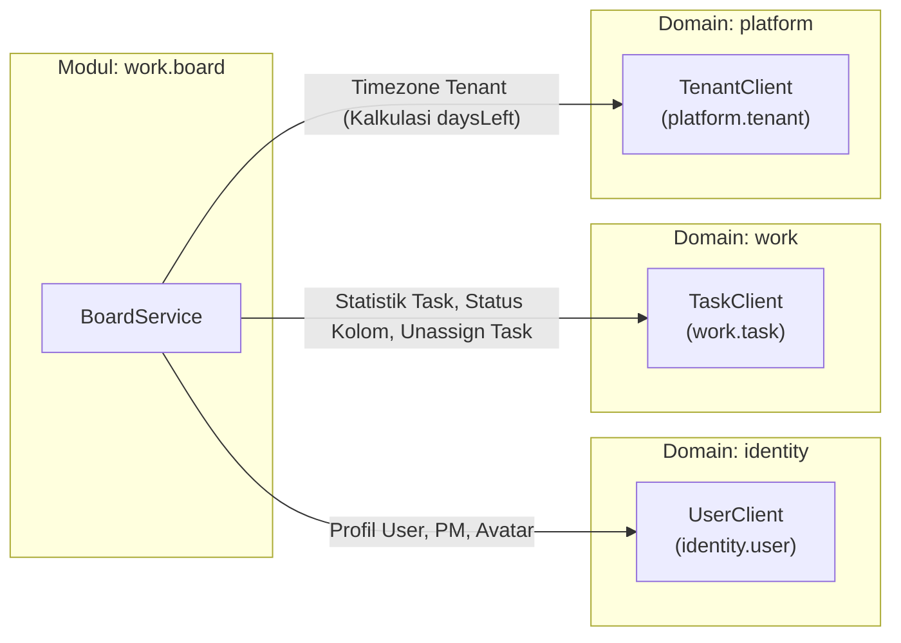

---

## 2. Ringkasan Endpoint Modul Board

| API ID | Method | Path | Kebutuhan Client Eksternal | Header Khusus | Response DTO |
| :---: | :---: | :--- | :--- | :---: | :--- |
| **API-12** | `GET` | `/boards` | `UserClient`, `TaskClient` | — | `List<BoardSummaryResponse>` + meta |
| **API-66** | `GET` | `/boards/cards` | `TaskClient`, `UserClient`, `TenantClient` | — | `List<BoardCardResponse>` + meta |
| **API-13** | `GET` | `/boards/{boardId}` | `TaskClient`, `UserClient` | — | `BoardDetailResponse` |
| **API-49** | `POST` | `/boards` | `UserClient` | `Idempotency-Key` | `201 Created` $\rightarrow$ `BoardDetailResponse` |
| **API-50** | `PUT` | `/boards/{boardId}` | `UserClient` | `If-Match` | `BoardDetailResponse` |
| **API-51** | `DELETE`| `/boards/{boardId}` | — *(Internal)* | `If-Match` | `null` (200 OK) |
| **API-23** | `GET` | `/boards/{boardId}/members` | `UserClient` | — | `List<BoardMemberResponse>` |
| **API-52** | `POST` | `/boards/{boardId}/invitations` | `UserClient` | `Idempotency-Key` | `BatchInvitationResponse` |
| **API-53** | `PATCH`| `/boards/{boardId}/members/{memberId}`| `UserClient` | `If-Match` | `BoardMemberResponse` |
| **API-54** | `DELETE`| `/boards/{boardId}/members/{memberId}`| `TaskClient` | `If-Match` | `null` (200 OK) |
| **API-67** | `GET` | `/boards/{boardId}/views` | — *(Internal)* | — | `List<SavedViewResponse>` |
| **API-68** | `POST` | `/boards/{boardId}/views` | — *(Internal)* | `Idempotency-Key` | `201 Created` $\rightarrow$ `SavedViewResponse` |

---

## 3. Detail Alur & Sequence Diagram per Endpoint

### API-12: GET /boards (List Ringkas Boards)
- **Tujuan**: Menampilkan daftar ringkas board yang dikelompokkan berdasarkan tab (`mine`, `shared`, `archived`) dengan filter group chip dan pagination cursor.
- **Relasi Modul**:
  - `UserClient`: Mengambil nama lengkap & inisial PM (`pmId`).
  - `TaskClient`: Fallback perhitungan health jika status board belum diisi (`overdue > 0` $\rightarrow$ `at_risk`).

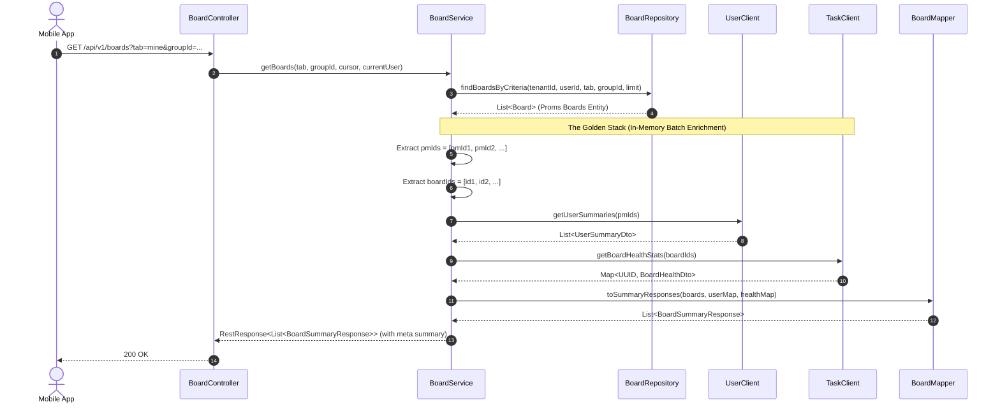

---

### API-66: GET /boards/cards (Card View Dashboard)
- **Tujuan**: Menampilkan representasi visual card view setiap board yang dilengkapi ringkasan matriks task (`todo`, `doing`, `blocked`, `done`), progress bar (`progressPct`), hitungan mundur jatuh tempo (`daysLeft`), dan avatar member (maksimal 3).
- **Relasi Modul**:
  - `Platform.tenant` (`TenantClient`): Mengambil timezone tenant untuk kalkulasi akurat `daysLeft` terhadap `dueDate`.
  - `Work.task` (`TaskClient`): Batch agregasi hitungan task per kategori kolom status.
  - `Identity.user` (`UserClient`): Batch pengambilan inisial & URL avatar untuk maksimal 3 member per board.

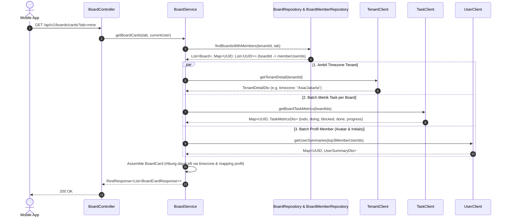

---

### API-13: GET /boards/{boardId} (Detail Board & Kolom)
- **Tujuan**: Mengambil struktur lengkap satu board saat dibuka pertama kali oleh aplikasi mobile (daftar kolom & WIP limit, workstream, member, dan hak akses permissions pengguna aktif).
- **Relasi Modul**:
  - `TaskClient`: Menghitung jumlah task aktif (`taskCount`) per masing-masing kolom board.
  - `UserClient`: Melengkapi data nama & avatar dari daftar `BoardMember`.

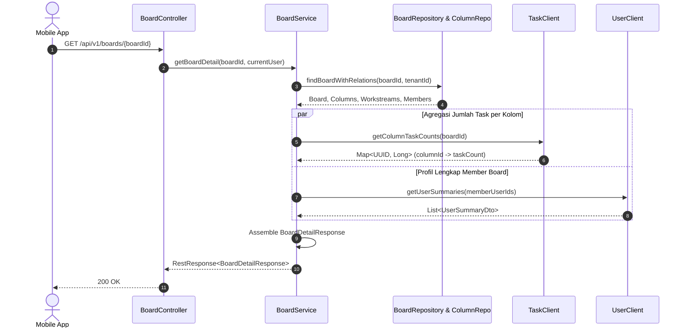

---

### API-49: POST /boards (Create Board Baru)
- **Tujuan**: Membuat board baru beserta inisialisasi kolom dari workflow template pilihan dan menambahkan creator/PM sebagai board member awal.
- **Relasi Modul**:
  - `UserClient`: Memvalidasi keberadaan dan status aktif user yang ditunjuk sebagai PM (`pmId`).

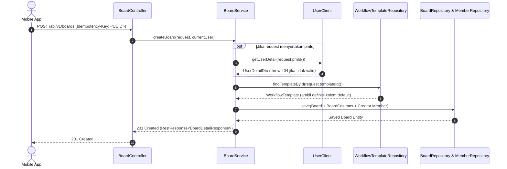

---

### API-50: PUT /boards/{boardId} (Update Info Board)
- **Tujuan**: Memperbarui metadata board (nama, key, clientName, groupName, PM, tanggal mulai/selesai).
- **Relasi Modul**:
  - `UserClient`: Memvalidasi user baru jika terjadi pergantian PM (`pmId`).

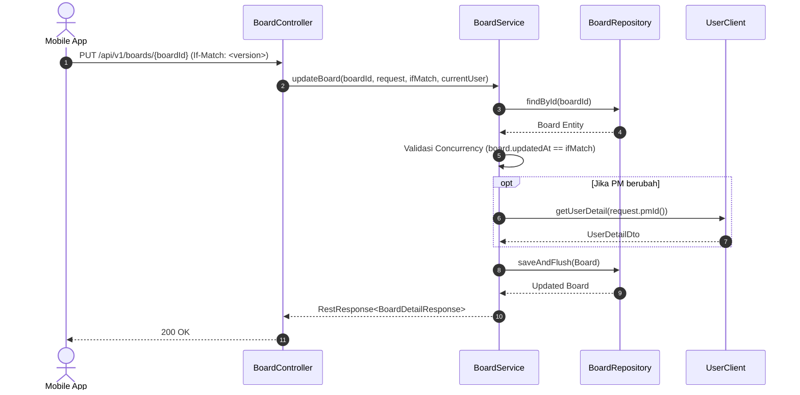

---

### API-51: DELETE /boards/{boardId} (Arsip / Soft-Delete Board)
- **Tujuan**: Mengarsipkan atau menghapus board secara logis (soft-delete).
- **Relasi Modul**: **Internal `work.board`** (tidak membutuhkan pemanggilan module lain).

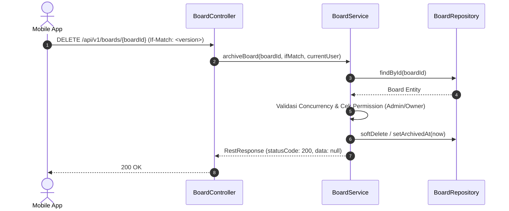

---

### API-23: GET /boards/{boardId}/members (List Member Board)
- **Tujuan**: Mengambil daftar seluruh anggota yang tergabung dalam board beserta undangan pending (`pendingInvitations`).
- **Relasi Modul**:
  - `UserClient`: Melakukan batch retrieval profil (nama, inisial, URL avatar) untuk seluruh `userId` yang ada di tabel `proms.board_members`.

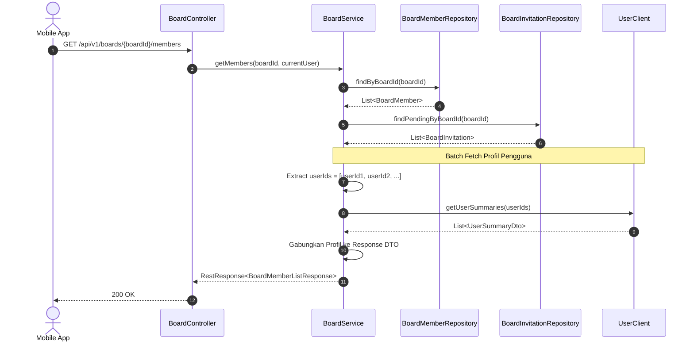

---

### API-52: POST /boards/{boardId}/invitations (Undang Member ke Board)
- **Tujuan**: Mengundang satu atau beberapa pengguna/email sekaligus ke board dengan role tertentu.
- **Relasi Modul**:
  - `UserClient`: Mengecek apakah email yang diundang sudah terdaftar di sistem/tenant. Jika ya, langsung dimasukkan ke `board_members`; jika belum, disimpan di `board_invitations`.

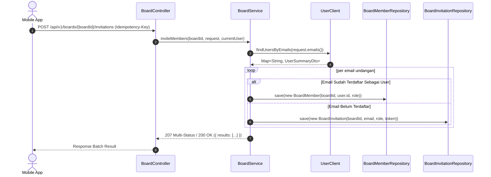

---

### API-53: PATCH /boards/{boardId}/members/{memberId} (Update Role/Workstream Member)
- **Tujuan**: Memperbarui role (`admin`, `pm`, `member`, `viewer`, `guest`) atau alokasi workstream dari seorang anggota board.
- **Relasi Modul**:
  - `UserClient`: Melengkapi profil user pada response akhir.

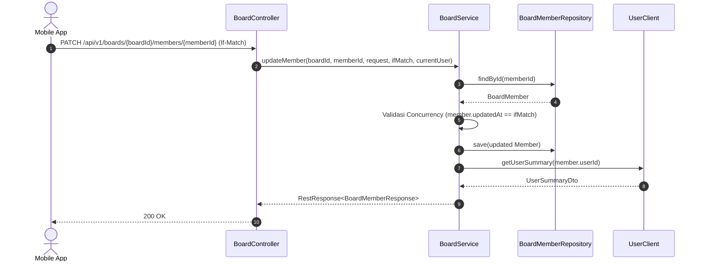

---

### API-54: DELETE /boards/{boardId}/members/{memberId} (Keluarkan Member)
- **Tujuan**: Menghapus anggota dari board. Sesuai aturan **BR-DL-04**, seluruh task di board yang sebelumnya di-assign ke user ini harus dilepaskan (unassign) agar tidak menjadi orphan.
- **Relasi Modul**:
  - `TaskClient`: Memanggil client modul task untuk melepaskan penugasan user pada board terkait (`unassignUserFromBoardTasks`).

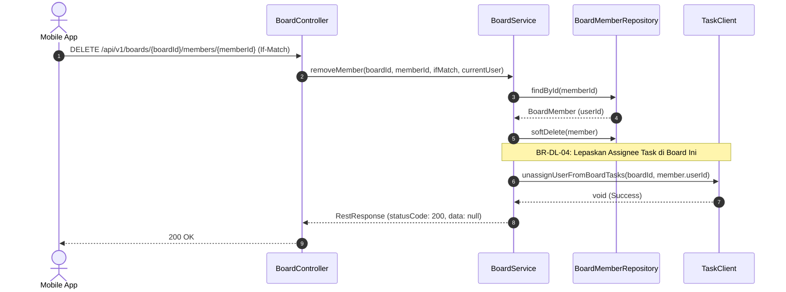

---

### API-67: GET /boards/{boardId}/views (List Custom Saved Views)
- **Tujuan**: Mengambil daftar filter/view kustom yang tersimpan untuk sebuah board (Kanban / List filter).
- **Relasi Modul**: **Internal `work.board`** (tabel `proms.board_saved_views`).

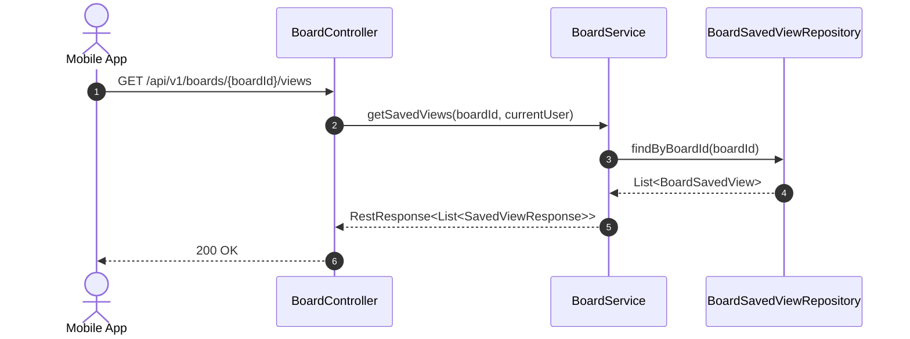

---

### API-68: POST /boards/{boardId}/views (Simpan Custom View)
- **Tujuan**: Menyimpan preset filter atau view baru pada board untuk dipakai kembali oleh tim.
- **Relasi Modul**: **Internal `work.board`** (tabel `proms.board_saved_views`).

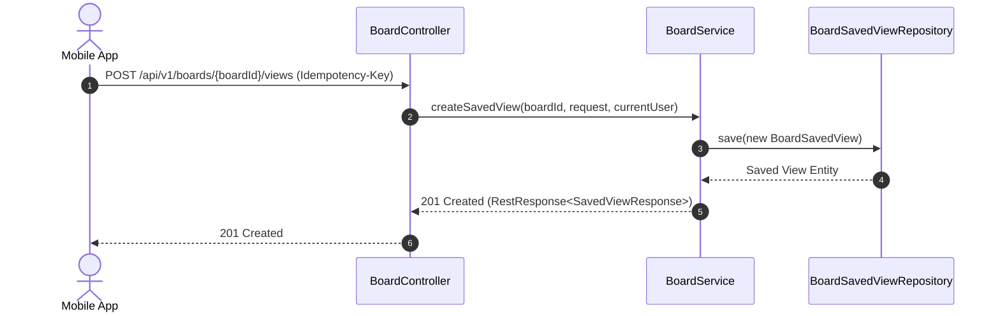

