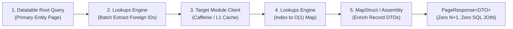

# Rule 11: The Golden Stack Pattern (Lookups, Anti-N+1 & In-Memory Enrichment)

> **CRITICAL ARCHITECTURAL PRINCIPLE**: To maintain strict modular isolation without sacrificing performance, datatables and listing endpoints must **NEVER** execute cross-module SQL `JOIN`s or import external JPA entities/repositories. Instead, all cross-module data enrichment must follow **The Golden Stack Architecture**.

---

## 1. The Three Pillars of The Golden Stack



### Pillar 1: In-Memory / L1 Caching (Caffeine & Spring Cache)
- Read-heavy master data (e.g. `CompanyInfo`, `UserInfo`, `CategorySummaryDto`, `TenantDetailDto`) should be cached at the `*Client` boundary or service queries.
- Eliminates database round-trips for repetitive lookups, bringing lookup latency down to sub-microsecond memory reads (`< 0.001 ms`).
- **Dedicated Module Cache Names**: Dilarang menggunakan string literal acak atau mengumpulkan cache names di `common`. Wajib mendeklarasikan cache names pada class konstanta khusus di masing-masing modul: `module.<domain>.<feature>.constant.<Feature>CacheNames`.
- **Tenant-Scoped Cache Isolation (Anti-RLS Bypass)**:
  - Cache L1 bekerja di memory aplikasi dan **tidak melewati PostgreSQL Row Level Security (RLS)**.
  - Untuk entitas/data yang berlingkup tenant (misal: product, order, task, dokumen), key cache **WAJIB menyertakan tenant prefix**, contoh:
    ```java
    @Cacheable(cacheNames = <Feature>CacheNames.<NAME>, key = "#tenantId + ':' + #id", unless = "#result == null")
    ```
    atau jika menggunakan context auth:
    ```java
    @Cacheable(cacheNames = <Feature>CacheNames.<NAME>, key = "#currentUser.activeTenantId() + ':' + #id", unless = "#result == null")
    ```
  - ❌ **DILARANG menggunakan `key = "#id"`** untuk data berlingkup tenant karena dapat mengakibatkan Tenant B membaca data Tenant A langsung dari cache tanpa pengecekan RLS database.
  - Pengecualian hanya untuk data global platform yang tidak memiliki `tenant_id` (seperti platform plans atau lookup tenant itu sendiri berdasarkan `tenantId`).
- **SpEL Handling pada Return Type `Optional<T>`**: Saat method mengembalikan `Optional<T>`, Spring Cache otomatis meng-unwrap value menjadi `T` (atau `null` jika empty). Maka evaluasi `unless` wajib menggunakan:
  ```java
  @Cacheable(cacheNames = <Feature>CacheNames.<NAME>, key = "#tenantId + ':' + #id", unless = "#result == null")
  ```
  *(Dilarang menggunakan `!#result.isPresent()`, yang akan memicu `SpelEvaluationException`)*.
- **Auto Eviction**: Gunakan `@CacheEvict(cacheNames = <Feature>CacheNames.<NAME>, key = "#tenantId + ':' + #id")` pada method mutasi data (create, update, delete).

### Pillar 2: `Lookups` Utility Engine (`com.hyperdata.proms.common.util.Lookups`)
- In-memory processing engine for batch ID extraction, one-to-one indexing, one-to-many grouping, safe transformations, and domain filtering.
- **Order Preservation**: Guarantees database sorting and pagination order preservation via `LinkedHashMap` and `LinkedHashSet`.
- **Null Safety**: 100% NPE-proof; null or empty collections safely yield empty collections instead of throwing exceptions.
- **Key Collision Safety**: `Lookups.toMap()` uses `putIfAbsent`, preventing `IllegalStateException` on duplicate keys.
- **Financial Precision**: Provides `Lookups.summingBy(...)` specifically for `BigDecimal` to avoid floating-point errors.
- **Dual-Mode Operation**: Supports both **Static 1-Liners** and **Fluent Chaining Pipelines**.

### Pillar 3: Declarative DTO Assembly (MapStruct)
- Keeps service classes clean by delegating DTO transformations to MapStruct or dedicated mapping helpers.
- Uses lookup maps passed into mapper methods or service helper functions (e.g. `toListItemResponse(entity, companyMap, categoryMap)`).

---

## 2. Standard Datatable Service Execution Flow

Every listing or datatable service resolving cross-module relationships must implement this exact 3-step pipeline:

```java
@Transactional(readOnly = true)
public PageResponse<ProductListItemResponse> getProducts(ProductFilter filter, Pageable pageable) {
    // STEP 1: Fetch paginated root entities (Local Repository)
    Page<Product> productPage = productRepository.findAll(ProductSpecs.of(filter), pageable);
    List<Product> products = productPage.getContent();
    if (products.isEmpty()) {
        return PageResponse.from(productPage);
    }

    // STEP 2: Batch extract foreign IDs & load relations (Zero N+1)
    Set<UUID> categoryIds = Lookups.extractIds(products, Product::getCategoryId);
    List<CategorySummaryDto> categories = categoryClient.findAllByIds(categoryIds);
    Map<UUID, CategorySummaryDto> categoryMap = Lookups.toMap(categories, CategorySummaryDto::id);

    Set<UUID> supplierIds = Lookups.extractIds(products, Product::getSupplierId);
    List<SupplierSummaryDto> suppliers = supplierClient.findAllByIds(supplierIds);
    Map<UUID, SupplierSummaryDto> supplierMap = Lookups.toMap(suppliers, SupplierSummaryDto::id);

    // STEP 3: In-Memory O(1) Assembly
    List<ProductListItemResponse> items = products.stream()
            .map(p -> {
                String categoryName = Lookups.find(categoryMap, p.getCategoryId(), CategorySummaryDto::name, "Unassigned");
                String supplierName = Lookups.find(supplierMap, p.getSupplierId(), SupplierSummaryDto::name, "Unknown");
                return productMapper.toListItemResponse(p, categoryName, supplierName);
            })
            .toList();

    return PageResponse.from(productPage, items);
}
```

---

## 3. Lookups Method Reference & Patterns

### A. Batch ID & Key Extraction
```java
// Extract unique Set<UUID>, automatically filtering nulls and blank values
Set<UUID> categoryIds = Lookups.extractIds(products, Product::getCategoryId);

// Extract across multiple ID fields in one pass
Set<UUID> allRelatedIds = Lookups.extractAllIds(orders, Order::getBillingAddressId, Order::getShippingAddressId);

// Extract ordered List
List<String> skus = Lookups.extractList(products, Product::getSku);

// Filter distinct elements by property (preserves first occurrence)
List<Product> uniqueCategoryProducts = Lookups.distinctBy(products, Product::getCategoryId);
```

### B. Indexing to Map ($O(1)$ Lookups)
```java
// Safe indexing into LinkedHashMap (no duplicate key crash)
Map<UUID, Product> productMap = Lookups.toMap(products, Product::getId);

// Custom key and value extractors
Map<UUID, String> productNameMap = Lookups.toMap(products, Product::getId, Product::getName);
```

### C. One-to-Many Grouping & Aggregations
```java
// Grouping by key into Map<UUID, List<Item>>
Map<UUID, List<OrderItem>> itemsByOrderId = Lookups.groupingBy(allOrderItems, OrderItem::getOrderId);

// Financial sum for BigDecimal (zero precision loss)
Map<UUID, BigDecimal> totalAmountByCustomer = Lookups.summingBy(orders, Order::getCustomerId, Order::getTotalAmount);

// Count occurrences
Map<String, Long> countByCategory = Lookups.countingBy(products, Product::getCategory);
```

### D. Safe DTO Resolution Helper
```java
// Safe get with fallback (null-safe)
String name = Lookups.find(categoryMap, catId, CategorySummaryDto::name, "Default");

// Safe resolve single entity unwrapping Optional
CategorySummaryDto category = Lookups.resolve(categoryId, categoryClient::findById);
```

### E. Fluent Chaining Pipeline (`Lookups.of(...)`)
```java
Map<UUID, CategorySummaryDto> categoryMap = Lookups.of(products)
        .activeOnly()
        .extractIds(Product::getCategoryId)
        .loadMap(categoryClient::findAllByIds, CategorySummaryDto::id);
```

---

## 4. Strict Guardrails for Agents

- **DO NOT** write SQL `JOIN` across tables belonging to different feature packages or modules.
- **DO NOT** inject a foreign repository or service into another module; call its `*Client` instead.
- **DO NOT** call a client inside a loop (`for (var item : list) client.findById(item.getId())`). Always use `Lookups.extractIds` and a batch client method `client.findAllByIds(ids)`.
- **DO NOT** hardcode cache names with string literals or store feature-specific cache names in `common`; use `<Feature>CacheNames` in `module.<domain>.<feature>.constant`.
- **DO NOT** use `!#result.isPresent()` in Spring Cache SpEL `unless` expressions; use `unless = "#result == null"` because Spring Cache unwraps `Optional`.
- **DO NOT** use `Collectors.toMap` for multi-item lists where keys could collide; use `Lookups.toMap`.
- **PREFER VARIABLE-BASED LOOKUPS**: Always use the explicit 3-step variable-based pattern (`Lookups.extractIds` -> `client call` -> `Lookups.toMap`) in service layers. Avoid fluent chaining (`Lookups.of(...)` / `loadMap(...)`) in business services for transparency, direct debuggability, and compile-time type clarity.
- **CLIENT BATCH LOOKUP CONTRACT**: Batch lookup methods on `*Client` interfaces **MUST** accept `Collection<ID> ids` (NOT `Set<ID>` or array) and return `List<Dto>` to ensure broad compatibility with callers.
- **ZERO `Object[]` PROJECTION**: Repository aggregations and projections must return Java 21 Record DTOs (`SELECT new com...Dto(...)`), never raw `Object[]` or `List<Object[]>`.
- **ALWAYS** use `Lookups` from `com.hyperdata.proms.common.util.Lookups`.

---

## 5. Code Examples: DOs and DON'Ts

### A. Service Layer In-Memory Enrichment

```java
// ❌ DON'T: Manual Java Streams boilerplate atau fluent chaining yang sulit di-debug
Map<UUID, UserSummaryDto> pmMap = userClient.findSummariesByIds(
    page.getContent().stream().map(Board::getPmId).filter(Objects::nonNull).collect(Collectors.toSet())
).stream().collect(Collectors.toMap(UserSummaryDto::id, Function.identity(), (a, b) -> a));

// ❌ DON'T: Fluent chaining tersembunyi yang rentan masalah tipe generic
Map<UUID, UserSummaryDto> pmMap = Lookups.of(page.getContent())
    .extractIds(Board::getPmId)
    .loadMap(userClient::findSummariesByIds, UserSummaryDto::id);

// ✅ DO: Variable-based 3 langkah eksplisit (mudah di-debug, type-safe, bersih)
Set<UUID> pmIds = Lookups.extractIds(page.getContent(), Board::getPmId);
List<UserSummaryDto> pmUsers = userClient.findSummariesByIds(pmIds);
Map<UUID, UserSummaryDto> pmMap = Lookups.toMap(pmUsers, UserSummaryDto::id);
```

### B. Repository Aggregations & Projections

```java
// ❌ DON'T: Mengembalikan Object[] atau List<Object[]> mentah
// Rawan ArrayIndexOutOfBoundsException, ClassCastException, dan NPE saat unboxing
@Query("SELECT bm.boardId, COUNT(bm.id) FROM BoardMember bm WHERE bm.boardId IN :boardIds GROUP BY bm.boardId")
List<Object[]> countMembersGroupedByBoardIds(@Param("boardIds") Collection<UUID> boardIds);

// Service caller (ANTI-PATTERN):
Map<UUID, Integer> memberCounts = Lookups.toMap(
    repo.countMembersGroupedByBoardIds(boardIds),
    row -> (UUID) row[0],
    row -> ((Number) row[1]).intValue() // ⚠️ Bahaya NPE dan ClassCastException
);

// ✅ DO: Gunakan Java 21 Record DTO Projection (Constructor Expression)
public record BoardMemberCountDto(UUID boardId, long count) {}

@Query("""
    SELECT new com.hyperdata.proms.module.pm.board.dto.BoardMemberCountDto(bm.boardId, COUNT(bm.id))
    FROM BoardMember bm
    WHERE bm.boardId IN :boardIds
    GROUP BY bm.boardId
""")
List<BoardMemberCountDto> countMembersGroupedByBoardIds(@Param("boardIds") Collection<UUID> boardIds);

// Service caller (TYPE-SAFE):
List<BoardMemberCountDto> countDtos = repo.countMembersGroupedByBoardIds(boardIds);
Map<UUID, Integer> memberCounts = Lookups.toMap(
    countDtos,
    BoardMemberCountDto::boardId,
    dto -> (int) dto.count() // 🛡️ 100% aman dan divalidasi compiler
);
```

### C. Client Batch Lookup Interface Contract

```java
// ❌ DON'T: Menggunakan Set<UUID> atau array spesifik yang membatasi caller
List<UserSummaryDto> findSummariesByIds(Set<UUID> userIds);

// ✅ DO: Menggunakan Collection<UUID> agar kompatibel dengan Set, List, atau LinkedHashSet
List<UserSummaryDto> findSummariesByIds(Collection<UUID> userIds);
```
