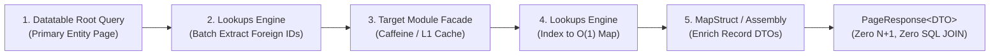

# Rule 11: The Golden Stack Pattern (Lookups, Anti-N+1 & In-Memory Enrichment)

> **CRITICAL ARCHITECTURAL PRINCIPLE**: To maintain strict modular isolation without sacrificing performance, datatables and listing endpoints must **NEVER** execute cross-module SQL `JOIN`s or import external JPA entities/repositories. Instead, all cross-module data enrichment must follow **The Golden Stack Architecture**.

---

## 1. The Three Pillars of The Golden Stack



### Pillar 1: In-Memory / L1 Caching (Caffeine & Spring Cache)
- Read-heavy master data (e.g. `CompanyInfo`, `UserInfo`, `CategorySummaryDto`) should be cached at the `*Facade` boundary.
- Eliminates database round-trips for repetitive lookups, bringing lookup latency down to sub-microsecond memory reads (`< 0.001 ms`).
- Evicted automatically on state mutations via `@CacheEvict`.

### Pillar 2: `Lookups` Utility Engine (`com.hyperdata.proms.common.util.Lookups`)
- In-memory processing engine for batch ID extraction, one-to-one indexing, one-to-many grouping, safe transformations, and domain filtering.
- **Order Preservation**: Guarantees database sorting and pagination order preservation via `LinkedHashMap` and `LinkedHashSet`.
- **Null Safety**: 100% NPE-proof; null or empty collections safely yield empty collections instead of throwing exceptions.
- **Key Collision Safety**: `Lookups.toMap()` uses `putIfAbsent`, preventing `IllegalStateException` on duplicate keys.
- **Financial Precision**: Provides `Lookups.summingBy(...)` specifically for `BigDecimal` to avoid floating-point errors.
- **Dual-Mode Operation**: Supports both **Static 1-Liners** and **Fluent Chaining Pipelines**.

### Pillar 3: Declarative DTO Assembly (MapStruct)
- Keeps service classes clean by delegating DTO transformations to MapStruct or dedicated mapping helpers.
- Uses lookup maps passed into mapper methods or service helper functions (e.g. `toListItemResponse(entity, companyMap, categoryMap)`).

---

## 2. Standard Datatable Service Execution Flow

Every listing or datatable service resolving cross-module relationships must implement this exact 3-step pipeline:

```java
@Transactional(readOnly = true)
public PageResponse<ProductListItemResponse> getProducts(ProductFilter filter, Pageable pageable) {
    // STEP 1: Fetch paginated root entities (Local Repository)
    Page<Product> productPage = productRepository.findAll(ProductSpecs.of(filter), pageable);
    List<Product> products = productPage.getContent();
    if (products.isEmpty()) {
        return PageResponse.from(productPage);
    }

    // STEP 2: Batch extract foreign IDs & load relations (Zero N+1)
    Set<UUID> categoryIds = Lookups.extractIds(products, Product::getCategoryId);
    Set<UUID> supplierIds = Lookups.extractIds(products, Product::getSupplierId);

    // Call target module facades in batch (never loop or join tables!)
    Map<UUID, CategorySummaryDto> categoryMap = Lookups.loadMap(
            categoryIds,
            categoryFacade::findAllByIds,
            CategorySummaryDto::id
    );
    Map<UUID, SupplierSummaryDto> supplierMap = Lookups.loadMap(
            supplierIds,
            supplierFacade::findAllByIds,
            SupplierSummaryDto::id
    );

    // STEP 3: In-Memory O(1) Assembly
    List<ProductListItemResponse> items = products.stream()
            .map(p -> {
                String categoryName = Lookups.find(categoryMap, p.getCategoryId(), CategorySummaryDto::name, "Unassigned");
                String supplierName = Lookups.find(supplierMap, p.getSupplierId(), SupplierSummaryDto::name, "Unknown");
                return productMapper.toListItemResponse(p, categoryName, supplierName);
            })
            .toList();

    return PageResponse.from(productPage, items);
}
```

---

## 3. Lookups Method Reference & Patterns

### A. Batch ID & Key Extraction
```java
// Extract unique Set<UUID>, automatically filtering nulls and blank values
Set<UUID> categoryIds = Lookups.extractIds(products, Product::getCategoryId);

// Extract across multiple ID fields in one pass
Set<UUID> allRelatedIds = Lookups.extractAllIds(orders, Order::getBillingAddressId, Order::getShippingAddressId);

// Extract ordered List
List<String> skus = Lookups.extractList(products, Product::getSku);

// Filter distinct elements by property (preserves first occurrence)
List<Product> uniqueCategoryProducts = Lookups.distinctBy(products, Product::getCategoryId);
```

### B. Indexing to Map ($O(1)$ Lookups)
```java
// Safe indexing into LinkedHashMap (no duplicate key crash)
Map<UUID, Product> productMap = Lookups.toMap(products, Product::getId);

// Custom key and value extractors
Map<UUID, String> productNameMap = Lookups.toMap(products, Product::getId, Product::getName);
```

### C. One-to-Many Grouping & Aggregations
```java
// Grouping by key into Map<UUID, List<Item>>
Map<UUID, List<OrderItem>> itemsByOrderId = Lookups.groupingBy(allOrderItems, OrderItem::getOrderId);

// Financial sum for BigDecimal (zero precision loss)
Map<UUID, BigDecimal> totalAmountByCustomer = Lookups.summingBy(orders, Order::getCustomerId, Order::getTotalAmount);

// Count occurrences
Map<String, Long> countByCategory = Lookups.countingBy(products, Product::getCategory);
```

### D. Safe DTO Resolution Helper
```java
// Safe get with fallback (null-safe)
String name = Lookups.find(categoryMap, catId, CategorySummaryDto::name, "Default");

// Safe resolve single entity unwrapping Optional
CategorySummaryDto category = Lookups.resolve(categoryId, categoryFacade::findById);
```

### E. Fluent Chaining Pipeline (`Lookups.of(...)`)
```java
Map<UUID, CategorySummaryDto> categoryMap = Lookups.of(products)
        .activeOnly()
        .extractIds(Product::getCategoryId)
        .loadMap(categoryFacade::findAllByIds, CategorySummaryDto::id);
```

---

## 4. Strict Guardrails for Agents

- **DO NOT** write SQL `JOIN` across tables belonging to different feature packages or modules.
- **DO NOT** inject a foreign repository or service into another module; call its `*Facade` instead.
- **DO NOT** call a facade inside a loop (`for (var item : list) facade.findById(item.getId())`). Always use `Lookups.extractIds` and a batch facade method `facade.findAllByIds(ids)`.
- **DO NOT** use `Collectors.toMap` for multi-item lists where keys could collide; use `Lookups.toMap`.
- **ALWAYS** use `Lookups` from `com.hyperdata.proms.common.util.Lookups`.
