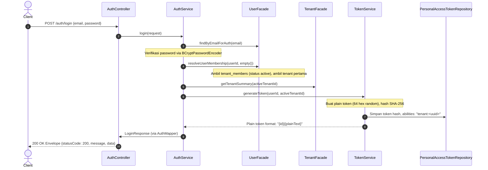
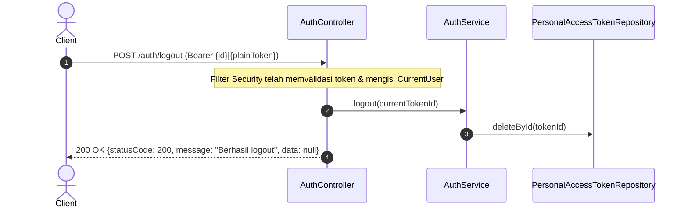
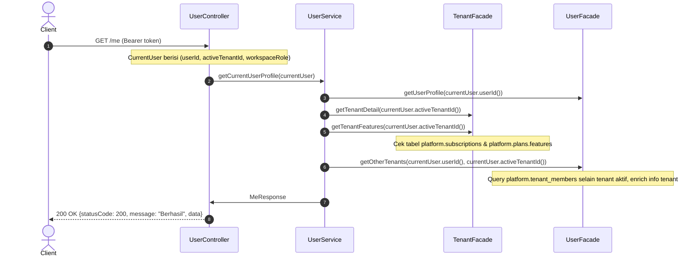

# Technical Design Specification: Auth & Profile Endpoints

- **Date**: 2026-11-02
- **Topic**: Authentication (`login`, `logout`) & User Profile (`me`) Endpoints
- **Target Repository**: `hyperdata-solusindo/proms-api-java`
- **Status**: Validated Design (Ready for Implementation Planning)

---

## 1. Executive Summary & Context

Sistem ini membutuhkan penyediaan endpoint autentikasi dan profil pengguna untuk mendukung layar aplikasi frontend:
- **API-01**: `POST /auth/login` (Layar 01 Login)
- **API-02**: `POST /auth/logout` (Layar 01 Logout)
- **API-03**: `GET /me` (Layar 02 Workspace, 15 Profil)

Desain ini menerapkan pola **2-Layer Modular Monolith** sesuai [`AGENTS.md`](../../AGENTS.md), memanfaatkan skema PostgreSQL `platform.*` yang telah tersedia (`users`, `tenants`, `tenant_members`, `personal_access_tokens`, `subscriptions`, `plans`), dan menggunakan mekanisme autentikasi **Personal Access Token (PAT)** berbasis *high-entropy secret* yang aman dan teruji di industri.

---

## 2. Directives & Architectural Compliance

Berdasarkan aturan master repositori:
1. **2-Layer Modular Monolith**: Modul diisolasi di bawah namespace `com.hyperdata.proms.module.<domain>.<feature>`.
2. **Inter-Module Facade Rule**: Komunikasi antar-modul (`auth` -> `user`, `user` -> `tenant`) hanya melalui `facade/<Feature>Facade.java`. Dilarang meng-inject `Service` atau `Repository` milik modul lain.
3. **No JPA Entity Leakage**: Entity JPA (`platform.*`) tidak pernah diekspos ke Controller atau Facade. Semua data transfer menggunakan Java 21 `record`.
4. **Validation**: Validasi input menggunakan YAVI (`Validator<T>`) pada DTO request.
5. **Object Mapping**: Konversi entity ke DTO menggunakan MapStruct dengan konfigurasi Spring Component Model.
6. **Stateless Security**: Spring Security 6 dikonfigurasi stateless (`SessionCreationPolicy.STATELESS`) dengan `OncePerRequestFilter` kustom untuk autentikasi Bearer PAT.

---

## 3. Package Structure & Modular Boundaries

```text
com.hyperdata.proms/
├── common/
│   ├── response/
│   │   └── ApiResponse.java                     # Mendukung format { statusCode, message, data }
│   └── security/
│       ├── SecurityConfig.java                  # SecurityFilterChain (stateless, CORS, CSRF disabled)
│       ├── TokenAuthenticationFilter.java       # Filter HTTP header Authorization: Bearer {id}|{token}
│       ├── CurrentUser.java                     # Record principal (userId, email, activeTenantId, workspaceRole, tokenId)
│       └── SecurityContextHelper.java           # Akses static aman ke CurrentUser
│
└── module/
    ├── identity/
    │   ├── auth/                                # Fitur Autentikasi
    │   │   ├── controller/
    │   │   │   └── AuthController.java          # POST /auth/login, POST /auth/logout
    │   │   ├── dto/
    │   │   │   ├── LoginRequest.java            # Record { email, password } + YAVI
    │   │   │   ├── LoginResponse.java           # Record data login
    │   │   │   └── AuthUserDto.java             # User profile ringkas saat login
    │   │   ├── entity/
    │   │   │   └── PersonalAccessToken.java     # Table: platform.personal_access_tokens
    │   │   ├── repository/
    │   │   │   └── PersonalAccessTokenRepository.java
    │   │   ├── mapper/
    │   │   │   └── AuthMapper.java              # MapStruct mapper
    │   │   └── service/
    │   │       ├── AuthService.java             # Logic login & logout
    │   │       └── TokenService.java            # Logic token generator, SHA-256 hash & verification
    │   │
    │   └── user/                                # Fitur User & Profil
    │       ├── controller/
    │       │   └── UserController.java          # GET /me
    │       ├── dto/
    │       │   ├── MeResponse.java              # Record data profil lengkap /me
    │       │   ├── UserProfileDto.java          # Record { id, fullName, email }
    │       │   └── OtherTenantDto.java          # Record { slug, name }
    │       ├── entity/
    │       │   ├── User.java                    # Table: platform.users
    │       │   └── TenantMember.java            # Table: platform.tenant_members
    │       ├── facade/
    │       │   ├── UserFacade.java              # Public interface
    │       │   ├── dto/
    │       │   │   ├── UserAuthDto.java         # Credential lookup untuk auth
    │       │   │   └── UserMembershipDto.java   # Active tenant & role info
    │       │   └── internal/
    │       │       └── DefaultUserFacade.java   # @Component implementasi UserFacade
    │       ├── mapper/
    │       │   └── UserMapper.java              # MapStruct mapper
    │       ├── repository/
    │       │   ├── UserRepository.java
    │       │   └── TenantMemberRepository.java
    │       └── service/
    │           └── UserService.java             # Logic pengumpulan data /me
    │
    └── platform/
        └── tenant/                              # Fitur Tenant & Subscription
            ├── entity/
            │   ├── Tenant.java                  # Table: platform.tenants
            │   ├── Subscription.java            # Table: platform.subscriptions
            │   └── Plan.java                    # Table: platform.plans
            ├── facade/
            │   ├── TenantFacade.java            # Public interface
            │   ├── dto/
            │   │   ├── TenantDetailDto.java     # Info detail tenant (id, slug, name, status, timezone)
            │   │   └── TenantSummaryDto.java    # Info ringkas tenant (id, slug, name)
            │   └── internal/
            │       └── DefaultTenantFacade.java # @Component implementasi TenantFacade
            ├── mapper/
            │   └── TenantMapper.java            # MapStruct mapper
            └── repository/
                ├── TenantRepository.java
                ├── SubscriptionRepository.java
                └── PlanRepository.java
```

---

## 4. Personal Access Token (PAT) Architecture

### 4.1. Format & Lifecycle
1. **Format Client**: `{id}|{plainToken}` (Contoh: `12|Xk9Ab3...`).
   - `id`: Primary key bigint pada tabel `platform.personal_access_tokens`.
   - `plainToken`: 40–64 karakter hex/alphanumeric acak hasil dari `SecureRandom`.
2. **Penyimpanan Database**:
   - Kolom `token` pada database **hanya menyimpan hash SHA-256** dari `plainToken` (hex string 64 char).
   - Kolom `tokenable_type`: `'User'`.
   - Kolom `tokenable_id`: UUID user.
   - Kolom `name`: Nama token/client (misal `'auth-session'`).
   - Kolom `abilities`: Menyimpan metadata session/tenant, misalnya `tenant:<tenant_id>`.
3. **Verifikasi Token**:
   - `TokenAuthenticationFilter` membaca header `Authorization: Bearer <id>|<plainToken>`.
   - Memisahkan `<id>` dan `<plainToken>`.
   - Query DB by `id` (lookup $O(1)$).
   - Menghitung SHA-256 dari `<plainToken>` dan membandingkannya dengan hash di DB.
   - Memastikan `expires_at` belum lewat dan user masih aktif.
   - Mengisi `SecurityContextHolder` dengan `CurrentUser`.
4. **Pencabutan Token (Logout)**:
   - Endpoint `POST /auth/logout` membaca `tokenId` dari `CurrentUser` yang aktif dan menghapusnya dari `platform.personal_access_tokens`.

---

## 5. API Contracts

### 5.1. API-01: `POST /auth/login` (Layar 01 Login)
- **Request Body**:
  ```json
  {
    "email": "fariz@hyperdata.co.id",
    "password": "SecretPassword123!"
  }
  ```
- **Validation**:
  - `email`: Not blank, format email valid.
  - `password`: Not blank.
- **Success Response (200 OK)**:
  ```json
  {
    "statusCode": 200,
    "message": "Berhasil login",
    "data": {
      "token": "12|Xk9...",
      "tokenType": "Bearer",
      "user": {
        "id": "0192...",
        "fullName": "Fariz Keren",
        "email": "fariz@hyperdata.co.id",
        "locale": "id",
        "timezone": "Asia/Jakarta"
      },
      "tenant": {
        "id": "0191...",
        "slug": "hyperdata",
        "name": "Hyperdata"
      },
      "workspaceRole": "member"
    }
  }
  ```

---

### 5.2. API-02: `POST /auth/logout` (Layar 01 Logout)
- **Security**: Membutuhkan header `Authorization: Bearer <id>|<plainToken>`.
- **Request Body**: None.
- **Success Response (200 OK)**:
  ```json
  {
    "statusCode": 200,
    "message": "Berhasil logout",
    "data": null
  }
  ```

---

### 5.3. API-03: `GET /me` (Layar 02 Workspace, 15 Profil)
- **Security**: Membutuhkan header `Authorization: Bearer <id>|<plainToken>`.
- **Request Body**: None.
- **Success Response (200 OK)**:
  ```json
  {
    "statusCode": 200,
    "message": "Berhasil",
    "data": {
      "user": {
        "id": "0192...",
        "fullName": "Fariz Keren",
        "email": "fariz@hyperdata.co.id"
      },
      "tenant": {
        "id": "0191...",
        "slug": "hyperdata",
        "name": "Hyperdata",
        "status": "active",
        "timezone": "Asia/Jakarta"
      },
      "workspaceRole": "member",
      "features": {
        "points": true,
        "standup": true
      },
      "otherTenants": [
        {
          "slug": "telemedis",
          "name": "Telemedis"
        }
      ]
    }
  }
  ```

---

## 6. Data Flow & Sequence Diagrams

### 6.1. Alur `POST /auth/login` (API-01)


### 6.2. Alur `POST /auth/logout` (API-02)


### 6.3. Alur `GET /me` (API-03)


---

## 7. Error Handling & HTTP Status Codes

Format respon error seragam mengikuti envelope:
```json
{
  "statusCode": 401,
  "message": "Email atau kata sandi tidak sesuai",
  "data": null
}
```

- **401 Unauthorized**:
  - Kredensial email/password salah.
  - Token Bearer tidak disertakan, tidak valid, atau sudah dicabut/kedaluwarsa.
- **403 Forbidden**:
  - User berstatus `is_active = false`.
  - Membership pada tenant berstatus `deactivated`.
- **422 Unprocessable Content**:
  - Validasi YAVI gagal (misal email kosong atau format salah):
    ```json
    {
      "statusCode": 422,
      "message": "Validasi gagal",
      "data": {
        "email": "Format email tidak valid"
      }
    }
    ```

---

## 8. Testing Strategy

1. **Unit Tests (BDD Style)**:
   - `AuthServiceTest`: Skenario login berhasil, login password salah, login user tidak ditemukan, logout mencabut token.
   - `TokenServiceTest`: Pembuatan token acak, hashing SHA-256, verifikasi integritas string token.
   - `UserServiceTest`: Pengambilan profil me, resolusi `features` dari subscription plan, mapping `otherTenants`.
2. **Integration / Controller Tests (MockMvc)**:
   - `AuthControllerTest`: Menguji format output JSON exact untuk `POST /auth/login` dan `POST /auth/logout`.
   - `UserControllerTest`: Menguji filter security Bearer token dan payload `GET /me`.
3. **Architecture Verification**:
   - `ArchitectureTest`: Memastikan tidak ada controller yang memanggil repository langsung, dan tidak ada entity JPA yang bocor melintasi batas modul.

---

## 9. Definition of Done (DoD) Checklist

- [ ] Dependensi `spring-boot-starter-security` terpasang di `build.gradle.kts`.
- [ ] Entitas JPA `User`, `TenantMember`, `PersonalAccessToken`, `Tenant`, `Subscription`, `Plan` terdefinisi sesuai skema `platform.*`.
- [ ] DTO request dan response dibuat sebagai Java 21 `record` flat di folder `dto/`.
- [ ] Validasi YAVI terimplementasi pada request DTO.
- [ ] Kontrak Facade (`UserFacade`, `TenantFacade`) terisolasi di `facade/` dan implementasinya di `facade/internal/`.
- [ ] Konversi entity ke DTO menggunakan MapStruct.
- [ ] Unit & Controller tests lulus dengan status hijau.
- [ ] `./gradlew test --tests "*ArchitectureTest*"` lulus tanpa pelanggaran arsitektur.
- [ ] `./gradlew spotlessApply` dijalankan dan kode rapi.
