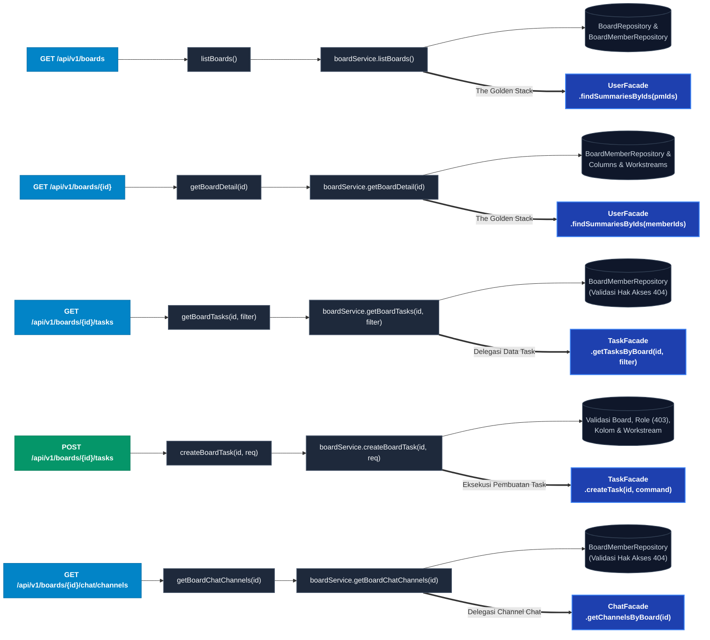

# Spesifikasi Desain: Core Board Module & Endpoint Integrasi (/boards/**)

- **Tanggal**: 2026-11-10
- **Status**: Draft untuk Review
- **Target Domain & Feature**: `com.hyperdata.proms.module.pm.board`
- **Target Integrasi Modul Terkait**: 
  - `com.hyperdata.proms.module.identity.user` (The Golden Stack / User enrichment)
  - `com.hyperdata.proms.module.pm.task` (Task Kanban & Quick Add Task)
  - `com.hyperdata.proms.module.communication.chat` (Board Chat Channels)
- **Referensi Dokumen**: 
  - [`docs/mobile-v1-api-mapping-spring.md`](../mobile-v1-api-mapping-spring.md)
  - Master Directive [`AGENTS.md`](../../AGENTS.md)
  - Rule 01 (Arsitektur 2-Layer Modular Monolith), Rule 03 (YAVI), Rule 11 (The Golden Stack)

---

## 1. Ringkasan & Ruang Lingkup

Spesifikasi ini mencakup implementasi backend Java Spring Boot untuk seluruh endpoint yang diawali dengan prefix path `/api/v1/boards/**` pada aplikasi PROMS:

| ID | Method & Path | Fungsi Utama | Konsumsi Lintas Modul |
|---|---|---|---|
| **API-12** | `GET /api/v1/boards` | Daftar board user (`tab=mine\|shared\|archived`) | `UserFacade.findSummariesByIds` (Golden Stack) |
| **API-13** | `GET /api/v1/boards/{boardId}` | Detail board (kolom, workstream, member, izin) | `UserFacade.findSummariesByIds` (Golden Stack) |
| **API-23** | `GET /api/v1/boards/{boardId}` (`members`) | Autocomplete mention `@` pada form komentar | Bagian dari payload API-13 |
| **API-14** | `GET /api/v1/boards/{boardId}/tasks` | Daftar task Kanban board terurut kolom & posisi | `TaskFacade.getTasksByBoard` |
| **API-19** | `POST /api/v1/boards/{boardId}/tasks` | Quick add task baru di board | `TaskFacade.createTask` |
| **API-44** | `GET /api/v1/boards/{boardId}/chat/channels` | Channel percakapan yang terikat ke board | `ChatFacade.getChannelsByBoard` |

---

## 2. Diagram Alur & Pemetaan Arsitektur

Berikut adalah diagram alur visual dari request HTTP, kontroler, service, hingga database internal dan fasad eksternal:


### Diagram Alur Mermaid

[Buka di Mermaid Live Editor](https://mermaid.live/edit#pako:rZVrb9owFIb_ipVKFUhQyI1LtlYal3XTNq0q3fah7IMTO2DlYuY47VDb_z7buIEaQjdp-RBk-5z3vH58iB-siCJsBcCKU3ofLSHj4PP1PAfiiVJYFBMcgwXm0xWISZoGJ11n4EX9VsEZTbAYur0htFsRTSkLTmL1tGKa8_Y9JoslD0KaojeG3ooWO4L-sNcbbgW9_sDv_6Ngwe60mo2doRtWal7f9yvx9j1BfBnYZ_7qd1VgEMM4MvVQ-GwutvsOrORc17N9_4hcFCIf26ZcDCOIcOXQ68J4KxkOnLj3UtLZ8VcLYFNjat_OrcvpDejAFenc2Z2QQoaKufUzCILNubXbF2Asw1JS8JFabjQ3AZKbXJ7JZZU5w-yORPjsYOym5MxWOZORfduYWyroGosjJZyyNTh9G7LOhZr9grMQs-3a3GpKIRRWOufnF49z62aJwaXYFM7BjMMomVuP4L109K3A7L1ip0TPYpKjWZllkBFcjNYfhblVJt7a4QZzRcY5SKbzQNDTHh4ZK4bK9gRzSNIGQSYkx4R0JENv0dGonAqVCUUDG9O0zPICnIIflCWiGzDMChOYcwyY83fAMlW_FppbD63DYZHsd5a7g-5GRggOLdnrHDOToFtHsD5Rb93VIN1akGrHje8wJQgWBHyACXiXFLgAXtdrmiRdTXKCU7yQ4RPIIZAuFEvpUw52WQqryuVorcrvmzVIekLj6uvsVZT6Y6hYypxIHD3HFRVVh-FfJkrPRPlqnt66p0l6kmSFS-W1wDVNMWh4XbfZUrv-JL5C2YumNEl6muRUsE5KoXQlzqUUNPMtTu8Azo3dymlERZfm6DBK_0hTiiuLy1ee43S_Of2d5hyLyLEOPPDv9ut6szZPE_A1UP__tKZvtqauLX-5wimdyoHRnc8etw1q0LRawMowyyBB4sJ_sPgSZ-rqR5Al1pNYhSWns3UeiUnOSixmyhUSxzQhcMFgpqef_gA)



---

## 3. Struktur Package & Komponen

```text
src/main/java/com/hyperdata/proms/module/pm/board/
├── constant/
│   └── BoardCacheNames.java            # Konstanta nama cache tenant-isolated (L1 Cache)
├── controller/
│   ├── BoardApi.java                   # Contract Interface: routing HTTP & anotasi OpenAPI (@Tag, @Operation)
│   └── BoardController.java            # Thin RestController: hanya inject BoardService & return RestResponse<T>
├── service/
│   └── BoardService.java               # Transactional Service: orkestrasi bisnis, validasi, & delegasi Facade
├── facade/
│   ├── BoardFacade.java                # Public Contract Interface untuk konsumsi modul luar
│   ├── dto/
│   │   ├── BoardSummaryDto.java        # Record DTO ringkasan board untuk modul luar
│   │   └── BoardPermissionDto.java     # Record DTO hak akses & role user pada board
│   └── internal/
│       └── DefaultBoardFacade.java     # Hidden Implementation (@Component)
├── repository/
│   ├── BoardRepository.java            # JpaRepository & JpaSpecificationExecutor untuk proms.boards
│   ├── BoardMemberRepository.java      # Repository untuk proms.board_members
│   ├── BoardColumnRepository.java      # Repository untuk proms.board_columns
│   ├── WorkstreamRepository.java       # Repository untuk proms.workstreams
│   └── spec/
│       └── BoardSpecs.java             # Dynamic JPA Specifications (filter tab, status, search 'q')
├── entity/
│   ├── Board.java                      # JPA Entity (@Getter, @Setter, @NoArgsConstructor, bukan @Data)
│   ├── BoardMember.java                # JPA Entity keanggotaan board & role
│   ├── BoardColumn.java                # JPA Entity kolom board & WIP limit
│   └── Workstream.java                 # JPA Entity workstream board
├── mapper/
│   └── BoardMapper.java                # MapStruct interface (ReportingPolicy.IGNORE, componentModel = "spring")
└── dto/
    ├── BoardSummaryResponse.java       # Record DTO untuk item list GET /boards (API-12)
    ├── BoardDetailResponse.java        # Record DTO untuk detail GET /boards/{id} (API-13)
    ├── BoardMemberResponse.java        # Record DTO untuk member list (API-23)
    ├── BoardColumnResponse.java        # Record DTO untuk kolom
    ├── WorkstreamResponse.java         # Record DTO untuk workstream
    └── CreateBoardTaskRequest.java     # Record DTO input untuk POST /boards/{id}/tasks (API-19)
```

---

## 4. Logika Bisnis & Detail Implementasi di `BoardService`

### 4.1. List Boards (`API-12`)
1. **Root Query**: Eksekusi `boardRepository.findAll(BoardSpecs.withFilters(tab, q, userId, cursor), pageable)`.
2. **The Golden Stack Batch Extraction**:
   - `Set<UUID> pmIds = Lookups.toSet(boards, Board::getPmId);`
   - Ambil profil PM via `userFacade.findSummariesByIds(pmIds)` (O(1) in-memory lookup map).
3. **Batch Lookup Relasi Internal**:
   - Hitung total anggota per board: `boardMemberRepository.countMembersByBoardIds(boardIds)`.
   - Ambil role user saat ini: `boardMemberRepository.findRolesByUserAndBoardIds(userId, boardIds)`.
4. **Assembly**: Rakit entitas menjadi `BoardSummaryResponse` via `BoardMapper` tanpa raw SQL JOIN.

### 4.2. Detail Board & Members (`API-13` & `API-23`)
1. **Access Guard**:
   - Cari `BoardMember` berdasarkan `boardId` dan `currentUserId`. Jika tidak ditemukan, lempar `BoardNotFoundException` (`404 BOARD_NOT_FOUND`).
2. **Fetch Struktur Board**:
   - Ambil kolom aktif (`deleted_at is null`) terurut fractional index `position`.
   - Ambil workstream aktif (`deleted_at is null`) terurut `position`.
   - Ambil seluruh `BoardMember` board terkait.
3. **Enrichment Profil Member (The Golden Stack)**:
   - `Set<UUID> userIds = Lookups.toSet(members, BoardMember::getUserId);`
   - Panggil `userFacade.findSummariesByIds(userIds)` untuk melengkapi nama, foto profil, dan inisial.
4. **Permissions Evaluasi**:
   - `canManageStructure`: `isOwner || role in ("admin", "pm")`
   - `canCreateTask`: `isOwner || role in ("admin", "pm")` (member biasa belum diizinkan sesuai brief §2.5)
   - `canArchiveBoard`: `isOwner || role == "admin"`

### 4.3. Kanban Tasks (`API-14`)
1. **Akses Guard**: Validasi user adalah anggota board (`404` jika bukan).
2. **Perlakuan Role Guest**: Jika `member.getRole().equals("guest")`, set opsi `sharedWithClientOnly = true`.
3. **Delegasi Facade**: Panggil `taskFacade.getTasksByBoard(boardId, filter)`.

### 4.4. Quick Add Task (`API-19`)
1. **Cek Arsip Board**: Jika `board.getStatus().equals("archived")` $\rightarrow$ lempar `BoardArchivedException` (`409 BOARD_ARCHIVED`).
2. **Cek Hak Buat Task**: Jika `!canCreateTask(member)` $\rightarrow$ lempar `AccessDeniedException` (`403 FORBIDDEN_TASK_CREATE`).
3. **Validasi Struktur**:
   - Validasi `workstreamId` terdaftar di board terkait.
   - Validasi `columnId` (jika tidak dikirim, ambil kolom default pertama kategori `not_started`).
4. **Delegasi Facade**: Panggil `taskFacade.createTask(boardId, command)`.

### 4.5. Board Chat Channels (`API-44`)
1. **Akses Guard**: Validasi user adalah anggota aktif board (`404 BOARD_NOT_FOUND`).
2. **Delegasi Facade**: Panggil `chatFacade.getChannelsByBoard(boardId)`.

---

## 5. Kontrak Antar-Modul (`TaskFacade` & `ChatFacade`)

### 5.1. `TaskFacade` (`com.hyperdata.proms.module.pm.task.facade`)
```java
public interface TaskFacade {
    PageResponse<TaskSummaryDto> getTasksByBoard(UUID boardId, BoardTaskFilterDto filter);
    TaskCreatedDto createTask(UUID boardId, CreateTaskCommand command);
}
```
- **Proses di Modul Task**:
  - `getTasksByBoard`: Query `proms.tasks`, batch fetch assignees dari `proms.task_assignees`, enrich profil via `UserFacade`, kalkulasi `dueState` (`late`/`soon`/`ok`).
  - `createTask`: Generate UUID v7, hitung fractional index `position`, insert task ke database (trigger `proms.assign_task_number()` mengisi `number`), simpan assignees, tulis baris jejak ke `proms.task_activities`, dan simpan event ke `proms.outbox_events` (`TaskCreated`).

### 5.2. `ChatFacade` (`com.hyperdata.proms.module.communication.chat.facade`)
```java
public interface ChatFacade {
    List<ChatChannelSummaryDto> getChannelsByBoard(UUID boardId);
}
```
- **Proses di Modul Chat**:
  - `getChannelsByBoard`: Query `proms.chat_channels` dengan syarat `board_id = :boardId AND scope = 'board' AND deleted_at IS NULL`.
  - Batch fetch latest message dari `proms.chat_messages`, hitung unread counter, dan enrich profil pengirim via `UserFacade`.

---

## 6. Format Envelope Respons & Penanganan Kesalahan

Semua respons sukses maupun error dibungkus dalam `RestResponse<T>` sesuai §3.2 dokumen panduan mobile:

```json
{
  "statusCode": 200,
  "message": "Berhasil",
  "data": { ... },
  "meta": { "nextCursor": null }
}
```

Format error standar:
```json
{
  "statusCode": 404,
  "message": "Board tidak ditemukan",
  "data": null,
  "error": {
    "code": "BOARD_NOT_FOUND",
    "detail": "Board ID tidak valid atau Anda bukan anggota dari board ini."
  }
}
```

---

## 7. Strategi Pengujian (Definition of Done)

1. **Targeted Unit & Service Testing**:
   - `BoardServiceTest`: Mock repository & facade; uji tab filter, isolasi hak akses, dan perakitan The Golden Stack.
   - `TaskServiceTest` & `ChatServiceTest`: Verifikasi logika internal masing-masing.
2. **Controller Contract Testing**:
   - `BoardControllerTest`: Verifikasi integritas envelope HTTP, status code 200/201/403/404/409, dan skema JSON.
3. **Architecture Guardrail Test**:
   - `./gradlew test --tests "*ArchitectureTest*"` untuk menjamin kepatuhan 100% pada aturan Modular Monolith (tidak ada entity leaking, constructor injection, interface segregation).
4. **Formatting**:
   - `./gradlew spotlessApply` untuk memastikan konsistensi gaya kode.
