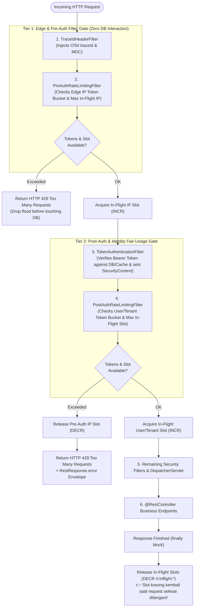

# Architecture Specification: Distributed Rate Limiter & Throttling

- **Status**: Draft / Under Review
- **Author**: Antigravity & User
- **Date**: 2026-11-11
- **Domain**: Infrastructure / Common Security (`com.hyperdata.proms.common.ratelimit`)
- **Directives Alignment**: Java 21, Spring Boot 4.1.x, Modular Monolith, Rule 06 (API Envelope), Rule 13 (Observability), Rule 14 (Security & Multi-Tenancy), Rule 16 (Zero Magic Strings).

---

## 1. Executive Summary & Problem Statement

Endpoint autentikasi dan API bisnis memerlukan mekanisme pertahanan ganda:
1. Serangan **Credential Stuffing & Distributed Brute Force** pada endpoint login publik (`/api/v1/auth/login`).
2. Masalah **Noisy Neighbor** dan monopoli resource oleh single user atau single tenant pada API bisnis.
3. Serangan DoS / Web Scraping agresif pada endpoint publik.
4. **Server Resource Starvation** akibat terlalu banyak request berat dijalankan secara bersamaan (*concurrent in-flight traffic*).

Sistem mengadopsi arsitektur **Hybrid Distributed Rate Limiter & Concurrency Throttler**:
- **Token Bucket (Bucket4j + Redis)**: Mengontrol laju kecepatan (*pace/volume*, request per waktu).
- **In-Flight Semaphore (Redis Lua Atomic INCR/DECR)**: Mengontrol konkurensi simultan (*in-flight capacity*). Slot terpakai saat request masuk dan **langsung dibebaskan kembali ketika response selesai dikirim**.

---

## 2. Infrastructure & Dependency Architecture

### 2.1. Docker Services (`docker-compose.yml`, `docker-compose.staging.yml`, `docker-compose.prod.yml`)

Menambahkan container Redis 7 Alpine:

```yaml
redis:
  image: redis:7-alpine
  container_name: proms-redis
  restart: unless-stopped
  command: ['redis-server', '--appendonly', 'yes', '--requirepass', '${REDIS_PASSWORD:-platform_redis_pass}']
  ports:
    - '${REDIS_PORT:-6379}:6379'
  volumes:
    - redis_data:/data
  networks:
    - proms-net
```

### 2.2. Dependencies (`build.gradle.kts`)

- `org.springframework.boot:spring-boot-starter-data-redis`
- `com.bucket4j:bucket4j-redis:8.10.1`

### 2.3. Configuration Properties

Dikonfigurasi via `@ConfigurationProperties(prefix = "app.rate-limit")`:

- `enabled`: boolean toggle (`true`/`false`).
- **Tier 1: Global Edge Protection (Pre-Auth / IP-Level)**:
  - Global IP Rate: Capacity 100 requests, Refill 100 tokens / 1 second.
  - Global IP In-Flight Max Concurrent: 20 concurrent requests per IP.
  - Auth Login IP Rate: Capacity 15 requests, Refill 15 tokens / 1 minute.
- **Tier 2: Business & Identity Protection (Post-Auth / Target-Level)**:
  - Auth Target Account: Capacity 5, Refill 5 tokens / 1 minute.
  - Authenticated User Rate: Capacity 60, Refill 60 tokens / 1 minute.
  - Authenticated User In-Flight Max Concurrent: 10 concurrent requests per User ID.
  - Authenticated Tenant Rate: Capacity 1000, Refill 1000 tokens / 1 minute.
  - Authenticated Tenant In-Flight Max Concurrent: 50 concurrent requests per Tenant ID.
  - Public Anonymous Endpoint: Capacity 30, Refill 30 tokens / 1 minute.

---

## 3. Package & Class Design

File ditempatkan di `com.hyperdata.proms.common.ratelimit`:

```text
com.hyperdata.proms.common.ratelimit/
├── config/
│   ├── RateLimitProperties.java          # Type-safe configuration record/class
│   └── RedisRateLimitConfig.java         # LettuceBasedProxyManager bean configuration
├── constant/
│   ├── RateLimitErrorCodes.java          # Error code constants (RATE_LIMIT_EXCEEDED)
│   └── RateLimitHeaders.java             # Header constants (Retry-After, X-RateLimit-*)
├── resolver/
│   ├── RateLimitKeyResolver.java         # Base interface: List<RateLimitTarget> resolve(HttpServletRequest)
│   ├── ClientIpResolver.java             # Robust IP extractor (X-Forwarded-For, X-Real-IP, RemoteAddr)
│   ├── EdgeRateLimitResolver.java        # Pre-Auth IP resolver (Tier 1: rl:edge:ip:{clientIp})
│   ├── AuthRateLimitKeyResolver.java     # Auth endpoint resolver (rl:auth:account:{email})
│   └── UserRateLimitKeyResolver.java     # Authenticated resolver (Tier 2: rl:user:{userId} & rl:tenant:{tenantId})
├── filter/
│   ├── PreAuthRateLimitingFilter.java    # Tier 1 Filter: Registered BEFORE TokenAuthenticationFilter
│   └── PostAuthRateLimitingFilter.java   # Tier 2 Filter: Registered AFTER TokenAuthenticationFilter
└── model/
    ├── RateLimitTarget.java              # Java 21 Record holding key, capacity, and refill policy
    └── RateLimitResult.java              # Java 21 Record holding consumption result & wait time
```

---

## 4. Key Resolution Strategy & Policy Mapping (Two-Tier Model)

| Layer / Tier | Filter Location | Target Endpoint | Resolved Redis Key | Capacity & Refill | Primary Security Objective |
|---|---|---|---|---|---|
| **Tier 1: Global Edge** | Pre-Auth (Before TokenAuthFilter) | All Endpoints (`/*`) | `rl:edge:ip:{clientIp}` | 100 tokens / 1 sec | Mencegah Connection & DB Pool Exhaustion (DDoS/Spamming) sebelum database disentuh sama sekali. |
| **Tier 1: Auth Endpoint** | Pre-Auth (Before TokenAuthFilter) | `/api/v1/auth/login` | `rl:auth:ip:{clientIp}` | 15 tokens / 1 min | Mencegah Brute Force Login massal dari satu IP. |
| **Tier 2: Target Account** | Post-Auth / Post-Body Wrap | `/api/v1/auth/login` | `rl:auth:account:{email}` | 5 tokens / 1 min | Mencegah Distributed Credential Stuffing terhadap 1 akun tertentu dari ribuan IP botnet. |
| **Tier 2: Business User** | Post-Auth (After TokenAuthFilter) | Authenticated APIs | `rl:user:{userId}` | 60 tokens / 1 min | Fair Usage Policy, mencegah satu user memonopoli server. |
| **Tier 2: Business Tenant** | Post-Auth (After TokenAuthFilter) | Authenticated APIs | `rl:tenant:{tenantId}` | 1000 tokens / 1 min | Menjamin isolasi performa antar-tenant (Anti Noisy Neighbor). |
| **Tier 2: Public General** | Post-Auth (Anonymous) | `/docs`, `/swagger-ui` | `rl:public:ip:{clientIp}` | 30 tokens / 1 min | Mencegah scraping berlebihan pada dokumentasi dan static resources. |

---

## 5. Security & Filter Pipeline Order (Hybrid Token Bucket + In-Flight Concurrency)



---

## 6. Error Envelope Contract (Rule 06 Compliance)

Jika request melebihi kuota, sistem mengembalikan status HTTP 429:

```json
{
  "statusCode": 429,
  "message": "Terlalu banyak permintaan. Silakan coba lagi nanti.",
  "data": null,
  "error": {
    "code": "RATE_LIMIT_EXCEEDED",
    "detail": "Batas permintaan terlampaui. Silakan tunggu 45 detik sebelum mencoba kembali."
  }
}
```

### Standard Headers:

- `Retry-After: 45`
- `X-RateLimit-Limit: 60`
- `X-RateLimit-Remaining: 0`
- `X-RateLimit-Reset: 1762853100`
- `X-Trace-Id: 0af7651916cd43dd8448eb211c80319c`

---

## 7. Resilience & Degradation (Fail-Open)

- Jika Redis mengalami down / connection timeout:
  - Error ditangkap (`catch (RedisException | QueryTimeoutException ex)`).
  - Log error via SLF4J dan kirim event ke Sentry.
  - Request diizinkan lewat (_fail-open_) agar ketersediaan aplikasi bisnis utama tetap terjaga (_high availability_).

---

## 8. Testing & Verification Plan

1. **Unit Tests**:
   - `RateLimitKeyResolverTest`: Validasi ekstraksi IP (termasuk validasi header `X-Forwarded-For`), ekstraksi email payload tanpa merusak input stream, dan resolusi `CurrentUser`.
   - `RateLimitPlanServiceTest`: Validasi pembuatan rule bandwidth Bucket4j.
2. **Integration / Filter Tests (`MockMvc`)**:
   - `RateLimitingFilterTest`:
     - Test request berurutan hingga kuota habis $\rightarrow$ response 429 dengan envelope `RestResponse.error`.
     - Test response headers (`Retry-After`, `X-RateLimit-*`).
     - Test fail-open behavior saat Redis mock melempar exception.
3. **Architecture & Quality Gates**:
   - `./gradlew test --tests "*ArchitectureTest*"`
   - `./gradlew spotlessApply && ./gradlew spotlessCheck`
   - `./gradlew check`
