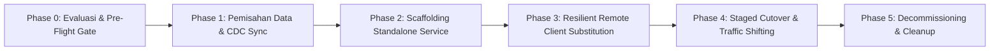

# SOP Migrasi Feature Modular Monolith ke Microservices (End-to-End Playbook)

**Document ID:** `SOP-ARCH-002`  
**Pola Arsitektur:** Strangler Fig Pattern & Zero-Rewrite Client Substitution  
**Target Platform:** Java 21, Spring Boot 3.3.x, Spring RestClient, Resilience4j, Kafka / Debezium CDC  
**Status:** Approved Standard Operating Procedure  

---

## 1. Ikhtisar & Tujuan SOP

SOP ini mengatur tata cara standar pemisahan (*decomposition*) suatu modul dari **Modular Monolith (`proms-api-java`)** menjadi **Microservice Mandiri (Standalone Service)**.

Tujuan utama SOP ini adalah menjamin:
1. **Zero-Downtime:** Transisi beban trafik berjalan bertahap tanpa pemadaman sistem.
2. **Zero-Data Loss:** Integritas dan konsistensi data terjaga penuh selama masa sinkronisasi basis data.
3. **Zero-Rewrite pada Konsumen:** Modul konsumen di monolit tidak mengalami perubahan satu baris kode bisnis pun.
4. **Instant Rollback (RTO < 60 detik):** Mekanisme pemulihan darurat jika microservice baru mengalami anomali di hari rilis.

---

## 2. Peta Fase Migrasi (End-to-End Pipeline)



---

## 3. Rincian Eksekusi Tiap Fase

### Fase 0: Evaluasi Kesiapan & Pre-Flight Gate

Sebelum modul boleh dipecah, Tech Lead wajib melakukan penilaian matriks pembobotan kesiapan:

| No | Parameter Evaluasi | Bobot | Kriteria Skor 5 (Sangat Siap) | Kriteria Skor 1 (Belum Siap) |
|:---|:---|:---:|:---|:---|
| 1 | **Beban Trafik & Auto-Scaling** | 25% | CPU/RAM modul mendominasi monolit, butuh penskalaan independen. | Beban trafik rendah, stabil bersama monolit. |
| 2 | **Kerapian Batas Kontrak (Zero Leak)** | 20% | 100% lulus ArchUnit. Semua modul lain hanya mengimpor `client/contract/` dan `client/dto/`. | Masih ada modul lain mengimpor `@Entity`, `Repository`, atau `Service`. |
| 3 | **Frekuensi Rilis & Tim Dedikasi** | 15% | Ada tim engineer dedikasi penuh yang butuh deploy harian/mandiri. | Dikelola tim bersama, jadwal rilis serentak dengan monolit. |
| 4 | **Isolasi Database & Beban Transaksi** | 15% | 100% bebas physical Foreign Key cross-module. Bebas transaksi ACID lintas modul. | Masih banyak FK database fisik dan `@Transactional` lintas modul. |
| 5 | **Sensitivitas Keamanan & Regulasi** | 15% | Mengelola PII, PCI-DSS, atau audit kepatuhan ketat (misal `identity`/`payment`). | Data operasional standar tanpa audit regulasi khusus. |
| 6 | **Toleransi Latensi Jaringan** | 10% | Modul sudah mendukung batch query (`Collection<UUID>`) dan toleran latensi HTTP (~5-15ms). | Sangat sensitif latensi (< 1ms in-memory) dan loop query N+1. |

> **Decision Gate:**
> * **Skor Total < 3.2**: DITOLAK. Tetap di Modular Monolith.
> * **Skor Total 3.2 - 3.9**: DITAHAN. Rapikan batas domain & hilangkan relasi database terlebih dahulu.
> * **Skor Total ≥ 4.0**: DISETUJUI untuk lanjut ke Fase 1.

**Pre-Flight Verification:**
```bash
./gradlew check
./gradlew test --tests "*ArchitectureTest*"
```

---

### Fase 1: Pemisahan Data & CDC Sync (Database Extraction)

Langkah paling berisiko adalah pemisahan database. Lakukan langkah-langkah berikut:
1. **Detasemen Foreign Key Fisik:**
   * Ubah seluruh `FOREIGN KEY` antar-tabel modul menjadi indeks biasa (`CREATE INDEX idx_... ON target_table(source_id)`).
   * Hubungan antar-domain murni menjadi *Logical Reference* berbasis UUID.
2. **Setup Database Baru:**
   * Buat instance database baru untuk microservice (misal: PostgreSQL instance tersendiri).
   * Salin schema DDL tabel target domain ke database baru via Flyway/Liquibase migrasi.
3. **Data Replication & CDC (Change Data Capture):**
   * Gunakan **Debezium + Apache Kafka** untuk menangkap perubahan data dari DB monolit dan menyalinnya ke DB microservice baru secara realtime.
   * Lakukan *Initial Snapshot* untuk data historis, diikuti dengan *Streaming Mode* (CDC).
   * Verifikasi lag replikasi = 0 detik dan rekonsiliasi row count antar kedua basis data.

---

### Fase 2: Scaffolding Standalone Microservice

1. **Inisialisasi Repository Baru:**
   * Salin kode domain `module/<target-domain>/` (controller, service, repository, entity, mapper) ke repo baru.
2. **Penyediaan Internal REST API Contract:**
   * Ekspos endpoint dengan prefix `/api/v1/internal/...` khusus untuk konsumsi antar-service.
   * Dukung **Batch Endpoint** wajib (misal: `POST /api/v1/internal/<feature>/batch-lookup` menerima `Set<UUID>`).
3. **Standarisasi Keamanan Antar-Service (M2M Security):**
   * Service baru memvalidasi Secret M2M / Mutual TLS (mTLS) atau internal JWT token.
   * Validasi wajib header multi-tenancy: `X-Tenant-ID`.
4. **Verifikasi Operasional:**
   * Health check via `/actuator/health`.
   * Export trace dan metrics ke OpenTelemetry collector.

---

### Fase 3: Resilient Remote Client Substitution di Monolit

Modul pemanggil di monolit tidak boleh disentuh. Monolit mengganti adapter komunikasinya di `client/impl/`:

1. **Pertahankan Kontrak Publik:**
   * `client/contract/<Feature>Client.java` (Interface) -> **DILARANG BERUBAH**.
   * `client/dto/*` (Record DTO) -> **DILARANG BERUBAH**.
2. **Buat Implementasi Remote Client (`<Feature>ClientRemoteImpl`):**
   * Gunakan Spring `RestClient` dengan proteksi **Resilience4j**:
     * **Connect Timeout:** 1000 ms.
     * **Read Timeout:** 2500 ms.
     * **Circuit Breaker:** Membuka sirkuit jika 50% panggilan gagal dalam 10 detik.
     * **Retry Policy:** Maksimal 2x retry hanya untuk status HTTP 503 / network I/O error (idempotent request).
     * **Trace Propagation:** Otomatis inject header W3C `traceparent` dan `X-Tenant-ID`.
3. **Penyediaan In-Memory Dual-Switch (Feature Flag):**
   * Sediakan switcher via Spring `@ConditionalOnProperty` atau dynamic feature toggle:
     * `proms.clients.<feature>.mode = in-memory | remote`

---

### Fase 4: Staged Cutover & Traffic Shifting

Jangan langsung alihkan 100% trafik! Jalankan bertahap:

1. **Stage 1: Shadow Traffic (Dry Run):**
   * Monolit tetap mengeksekusi in-memory, tetapi secara asinkron menduplikasi request ke remote service.
   * Catat response time dan pastikan tingkat error remote service < 0.01%.
2. **Stage 2: Canary Shifting (10% Traffic):**
   * Arahkan 10% trafik baca (read) ke remote service via feature flag. Pantau CPU, RAM, koneksi database, dan Sentry error rate.
3. **Stage 3: Full Read Shifting (100% Read Traffic):**
   * Seluruh query pembacaan dialihkan ke remote service.
4. **Stage 4: Write Cutover (100% Write Traffic):**
   * Balik arah CDC: DB Microservice menjadi **Master Source of Truth**, dan data direplikasi balik ke DB Monolit (reverse sync) sebagai jaring pengaman rollback.

---

### Fase 5: Emergency Rollback & Decommissioning

#### Prosedur Rollback Darurat (RTO < 60 Detik):
Jika microservice baru mengalami lonjakan error atau kegagalan transaksi:
1. Ubah konfigurasi runtime / Consul / Spring Cloud Config:
   ```properties
   proms.clients.<feature>.mode=in-memory
   ```
2. Trafik langsung kembali dieksekusi oleh class in-memory tanpa memerlukan redeploy atau restart aplikasi monolit.
3. Matikan reverse CDC dan lakukan audit inkonsistensi data.

#### Prosedur Decommissioning (Pembersihan Total):
Dilakukan setelah masa observasi stabil (minimal 14 hari tanpa insiden di produksi):
1. **Di Monolith:**
   * Hapus folder `module/<target-domain>/<feature>/` (service, repository, entity, controller).
   * Hapus class `<Feature>ClientImpl.java` (in-memory).
   * Jadikan `<Feature>ClientRemoteImpl.java` sebagai satu-satunya implementasi permanen.
   * Hapus tabel terkait di DB Monolit melalui script Flyway migration baru.
2. **Matikan Pipeline CDC:**
   * Hapus connector Debezium dan topik Kafka sinkronisasi transisi.
3. **Sign-Off:**
   * Update arsitektur dokumentasi dan tandatangani serah terima operasional kepada tim pengelola microservice baru.

---

## 4. Definition of Done (DoD) Checklist

- [ ] Skor evaluasi kesiapan ≥ 4.0 dan telah disetujui Tech Lead / Architect.
- [ ] `./gradlew check` dan `ArchitectureTest` lulus 100%.
- [ ] Database standalone terpasang tanpa physical Foreign Key ke database monolit.
- [ ] CDC Debezium/Kafka berjalan dengan replication lag 0 ms.
- [ ] Internal REST API mendukung batch lookup (`Collection<UUID>`).
- [ ] Remote Client dilengkapi Circuit Breaker, Timeout, dan Retry (Resilience4j).
- [ ] Header multi-tenancy (`X-Tenant-ID`) dan trace context (`traceparent`) terpropagasi sempurna.
- [ ] Modul konsumen lulus targeted integration test tanpa 1 baris kode yang diubah.
- [ ] Uji coba Rollback Darurat berhasil dieksekusi di staging environment (RTO < 60 detik).
- [ ] Canary shifting 10% -> 50% -> 100% berjalan sukses di produksi selama minimal 14 hari.
- [ ] Seluruh kode lama dan tabel di database monolit telah didecommissioning secara bersih.
