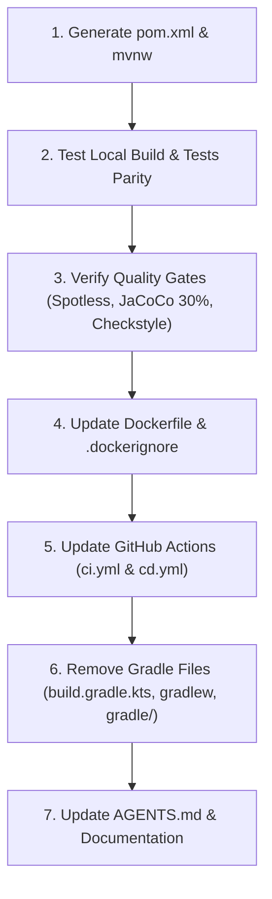

# Design Specification: Gradle to Maven Migration (Clean Break)

- **Date**: 2026-11-23
- **Author**: Antigravity Assistant & Engineering Team
- **Status**: Draft / Reviewing
- **Strategy**: Clean Break (Total replacement of Gradle with Maven)

---

## 1. Overview & Motivation
Project `hyperdata-solusindo/proms-api-java` saat ini menggunakan **Gradle (Kotlin DSL - `build.gradle.kts`)** dengan Spring Boot 4.1.2 dan Java 21. Migrasi ke **Apache Maven (`pom.xml`)** dilakukan untuk menyederhanakan deklarasi build yang berbasis XML standar, mempermudah interoperabilitas tooling, serta menyelaraskan dengan preferensi tim pada tahap awal development.

Karena status proyek masih berada dalam fase *early development*, strategi yang dipilih adalah **Clean Break**:
1. Menyiapkan `pom.xml` dan Maven Wrapper (`mvnw`).
2. Memverifikasi parity kompilasi, annotation processor, unit tests, coverage, dan quality gates.
3. Menghapus seluruh artefak Gradle (`build.gradle.kts`, `gradlew`, `gradle/`).
4. Memperbarui pipeline CI/CD (`ci.yml`, `cd.yml`), Dockerfile, `.dockerignore`, dan aturan `AGENTS.md`.

---

## 2. Core Build & Technology Mapping

| Aspect | Current (Gradle) | Target (Maven) | Keterangan / Solusi |
| :--- | :--- | :--- | :--- |
| **Toolchain** | Java 21 (Temurin) | Java 21 (`maven.compiler.release=21`) | Strict Java 21 byte code & language features |
| **Framework** | Spring Boot 4.1.2 plugin | `spring-boot-starter-parent:4.1.2` | Menjadi parent POM |
| **Packaging** | `bootJar` with layers | `spring-boot-maven-plugin` | `<layers><enabled>true</enabled></layers>` |
| **Build Wrapper** | `./gradlew` (Gradle 8.x) | `./mvnw` (Maven 3.9.x) | Dibuat via `mvn wrapper:wrapper` |
| **Build Output** | `build/libs/*.jar` | `target/*.jar` | Directory output default Maven adalah `target/` |

---

## 3. Annotation Processors & Compilation Ordering

Di Gradle:
```kotlin
annotationProcessor("org.projectlombok:lombok:1.18.36")
annotationProcessor("org.projectlombok:lombok-mapstruct-binding:0.2.0")
annotationProcessor("org.mapstruct:mapstruct-processor:1.6.3")
```

Di Maven, urutan annotation processor sangat sensitif dan **wajib** didefinisikan secara eksplisit di dalam `maven-compiler-plugin`:
```xml
<plugin>
    <groupId>org.apache.maven.plugins</groupId>
    <artifactId>maven-compiler-plugin</artifactId>
    <version>3.13.0</version>
    <configuration>
        <release>21</release>
        <annotationProcessorPaths>
            <path>
                <groupId>org.projectlombok</groupId>
                <artifactId>lombok</artifactId>
                <version>1.18.36</version>
            </path>
            <path>
                <groupId>org.projectlombok</groupId>
                <artifactId>lombok-mapstruct-binding</artifactId>
                <version>0.2.0</version>
            </path>
            <path>
                <groupId>org.mapstruct</groupId>
                <artifactId>mapstruct-processor</artifactId>
                <version>1.6.3</version>
            </path>
        </annotationProcessorPaths>
    </configuration>
</plugin>
```

---

## 4. Quality Gates & Linter Mapping

Seluruh quality gate wajib memiliki parity 1:1 terhadap standar yang ada:

### A. Spotless (Code Formatter)
- Menggunakan `spotless-maven-plugin` (v2.44.3).
- Konfigurasi XML Eclipse Formatter tetap merujuk pada `.vscode/eclipse-java-formatter.xml`.
- Perintah ekivalen:
  - Check: `./mvnw spotless:check`
  - Apply: `./mvnw spotless:apply`

### B. Checkstyle (Static Analysis)
- Menggunakan `maven-checkstyle-plugin` (v3.6.0) dengan `checkstyle` dependency v10.12.5.
- Konfigurasi tetap merujuk pada `config/checkstyle/checkstyle.xml`.
- Bind otomatis ke phase `verify`.

### C. JaCoCo (Code Coverage & DoD Threshold)
- Menggunakan `jacoco-maven-plugin` (v0.8.12).
- Rule DoD: Minimal **30% LINE coverage** pada bundle counter (sesuai `build.gradle.kts`).
- Exclusions:
  - `**/dto/**`
  - `**/entity/**`
  - `**/model/**`
  - `**/config/**`
  - `**/*Application*`
  - `**/*MapperImpl*`

---

## 5. CI/CD & Container Adjustments

### A. GitHub Actions CI (`.github/workflows/ci.yml`)
1. Ganti step `gradle/actions/setup-gradle` dengan caching bawaan `actions/setup-java@v4`:
   ```yaml
   - name: Set up JDK 21
     uses: actions/setup-java@v4
     with:
       java-version: '21'
       distribution: 'temurin'
       cache: 'maven'
   ```
2. Jalankan verifikasi Maven:
   ```yaml
   - name: Run Quality Gate & Tests
     run: ./mvnw clean verify
   ```

### B. GitHub Actions CD (`.github/workflows/cd.yml`)
1. Packaging:
   ```yaml
   - name: Package JAR
     run: ./mvnw clean package -DskipTests
   ```
2. Layer Extraction:
   ```yaml
   - name: Extract Spring Boot Layers
     run: |
       mkdir -p target/extracted
       java -Djarmode=tools -jar target/*.jar extract --layers --destination target/extracted
   ```

### C. Dockerfile & `.dockerignore`
- `docker/Dockerfile`: Mengambil JAR dari `target/*.jar`.
- `docker/Dockerfile.fast`:
  - `COPY target/extracted/dependencies/ ./`
  - `COPY target/extracted/spring-boot-loader/ ./`
  - `COPY target/extracted/snapshot-dependencies/ ./`
  - `COPY target/extracted/application/ ./`
- `.dockerignore`:
  - Abaikan `target/` kecuali extracted:
    ```dockerignore
    target/*
    !target/extracted
    !target/extracted/**
    ```

---

## 6. Developer Experience & AGENTS.md

### A. Perintah Harian Baru
| Aktivitas | Gradle | Maven |
| :--- | :--- | :--- |
| Targeted Test | `./gradlew test --tests "...*"` | `./mvnw test -Dtest=BoardControllerTest` |
| Format Code | `./gradlew spotlessApply` | `./mvnw spotless:apply` |
| Check Format | `./gradlew spotlessCheck` | `./mvnw spotless:check` |
| Full Quality Check | `./gradlew check` | `./mvnw clean verify` |
| Run App | `./gradlew bootRun` | `./mvnw spring-boot:run` |

### B. Pembaruan AGENTS.md
- Bagian Section 1: Update Build Tool dari Gradle ke Maven.
- Bagian Section 5 & 6: Ganti seluruh referensi `./gradlew` dengan `./mvnw`.

---

## 7. Migration Steps & Execution Plan



---

## 8. Definition of Done for this Migration
- [ ] `mvnw` dan `pom.xml` terpasang dan dapat mengompilasi proyek dengan Java 21 tanpa error.
- [ ] MapStruct dan Lombok bekerja dengan benar (tidak ada unresolved generated mapper).
- [ ] Seluruh unit test dan architecture test (`ArchitectureTest`) lulus via `./mvnw test`.
- [ ] JaCoCo menghasilkan report dan menegakkan threshold minimal 30% coverage.
- [ ] Spotless dan Checkstyle berhasil memvalidasi formatting.
- [ ] Layer extraction dan Docker build lokal berhasil menggunakan output `target/extracted`.
- [ ] File-file Gradle dihapus sepenuhnya dari repository.
- [ ] Dokumentasi dan `AGENTS.md` sinkron dengan perintah Maven.
